<div class="flex items-center gap-4 w-full">
  
  <span class="ud-pill">Programación · 1DAW · Curso 2026-2027</span>
</div>

# Programación Estructurada y Modular

### Creando código que decide, repite y se divide en módulos

<div class="mt-10 flex items-end justify-between w-full">
  <div class="text-left">
    <b class="text-lg">José Luis González Sánchez</b><br/>
    <span class="opacity-70">IES Luis Vives · Leganés · <a href="https://joseluisgs.dev">joseluisgs.dev</a></span>
  </div>
  <PacMan :size="54" label="Cargando ideas..." />
</div>

---

## 📦 Materiales de la unidad

Todo el material de la UD02 está publicado en el repositorio de GitHub, organizado por carpetas:

<div class="grid grid-cols-2 gap-6 items-start">
<div>

- 📚 **5 puntos** — teoría, ejemplos reales y resúmenes
- 📝 **Prácticas** — ejercicios graduados en `practicas/`
- 💻 **Soluciones** — más de 50 programas C# resueltos
- 🖼️ **Imágenes y recursos** — diagramas y esquemas en `images/`
- 🎬 **Vídeos** — lista de reproducción en YouTube

</div>
<div class="flex flex-col items-center justify-center gap-4 pt-4">

<RepoBadge caption="Repositorio con materiales de la unidad" />

<div class="text-sm opacity-75 text-center max-w-55">

Clónalo, forquéalo o descárgalo en zip: el material siempre está a un clic.

</div>

</div>
</div>

---

## 📚 Índice: los 5 puntos del tema

<div class="grid grid-cols-3 gap-3 text-sm">

<TopicCard :num="1" title="Introducción" desc="El paradigma y por qué importa" />
<TopicCard :num="2" title="Programación estructurada" desc="Secuencias, condicionales y bucles" />
<TopicCard :num="3" title="Programación modular" desc="Funciones, parámetros y recursividad" />
<TopicCard :num="4" title="Control de excepciones" desc="Lanzar, capturar y prevenir errores" />
<TopicCard :num="5" title="Resumen" desc="Mapa, errores y checklist" />

</div>

<div class="ud-card mt-4 flex items-center justify-between gap-4 px-4 py-2">

<span class="text-sm">📦 <b>Materiales:</b> los 5 puntos, prácticas, soluciones y vídeos de la unidad</span>

<RepoBadge />

</div>

---

## 🎯 Resultados de aprendizaje y criterios

<RaaCcee
  code="RA3"
  title="Escribe y depura código, analizando y utilizando las estructuras de control del lenguaje."
  :ccee="[
    'Se ha escrito y probado código que haga uso de estructuras de selección.',
    'Se han utilizado estructuras de repetición.',
    'Se han reconocido las posibilidades de las sentencias de salto.',
    'Se ha escrito código utilizando control de excepciones.',
    'Se han creado programas ejecutables utilizando diferentes estructuras de control.',
    'Se han probado y depurado los programas.',
    'Se ha comentado y documentado el código.',
    'Se han creado excepciones.',
    'Se han utilizado aserciones para la detección y corrección de errores durante la fase de desarrollo.',
  ]"
/>

---
layout: section
---

<div class="ud-section-number">01</div>

# Introducción

<div class="opacity-70">Paradigma estructurado, modular y por qué importa</div>

---

## 1 · Punto de partida

<div class="grid grid-cols-2 gap-5 items-start">
<div>

<TipBox type="consejo" title="Punto de partida">

¿Alguna vez has seguido una receta de cocina **sin pasos numerados**? ¿O has armado un mueble sin instrucciones? Eso es programar sin estructura: el código funciona (a veces), pero nadie lo entiende ni lo puede mantener.

</TipBox>

</div>
<div>

<Objetivos
  :items="[
    'Comprender qué es la programación estructurada y modular',
    'Diferenciar entre programación estructurada y modular',
    'Conocer las tres estructuras de control básicas',
    'Entender la conexión con los conceptos de la UD01',
  ]"
/>

</div>
</div>

---

## Un paradigma, dos ideas

<div class="grid grid-cols-2 gap-4 items-start">
<div>

- **Estructurada**: el código se escribe usando solo **tres estructuras de control** (secuencia, condicional, bucle). Sin saltos desordenados.
- **Modular**: el código se divide en **piezas pequeñas y reutilizables** (funciones y procedimientos). Sin todo en un solo sitio.

<TipBox type="nota">

En la UD01 viste los paradigmas. Este es el tuyo: **estructurado + modular** son la base de todo lo que viene después.

</TipBox>

</div>
<div>

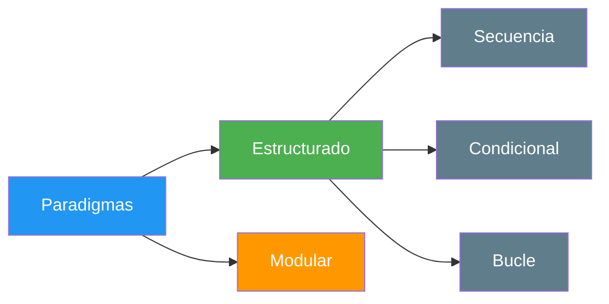

</div>
</div>

---

## Del código espagueti al código estructurado

Antes de este paradigma el código fluía mediante saltos incondicionales (`GOTO`): el **código espagueti**, una maraña de saltos imposible de mantener.

<div class="grid grid-cols-2 gap-4 items-start">
<div>

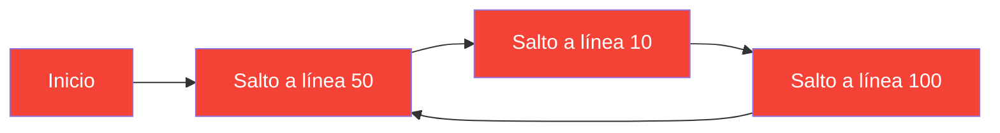

**Código espagueti:** nunca sabes dónde estás.

</div>
<div>

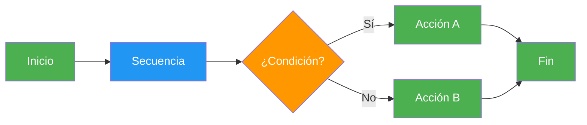

**Código estructurado:** siempre sabes qué sigue.

</div>
</div>

<TipBox type="consejo">

Con las tres estructuras de control **no necesitas `goto`**: el código es predecible y fácil de depurar.

</TipBox>

---

## Del caos al orden: la analogía de la empresa

Un programa bien estructurado es como una **empresa bien organizada**:

<div class="grid grid-cols-2 gap-5 items-start">
<div>

| Empresa | Programa |
|---------|----------|
| Cada departamento tiene una función clara | Cada módulo tiene una responsabilidad |
| Existen protocolos para tomar decisiones | Condicionales (`if`, `switch`) |
| Se repiten procesos cada mes | Bucles (`while`, `for`) |
| Un empleado no hace todo solo | Modularidad: funciones y procedimientos |

</div>
<div>

<RealExample app="Netflix">

Usa programación estructurada en el flujo de reproducción: secuencia (cargar vídeo → reproducir → pausar), condicionales (¿está suscrito? ¿hay conexión?) y bucles (¿seguir con la siguiente serie?).

</RealExample>

<TipBox type="analogia">

**Estructurado** es el organigrama: cada persona tiene su puesto. **Modular** es que además el trabajo esté repartido en archivos separados, no todo en el mismo despacho.

</TipBox>

</div>
</div>

---

## El mapa de la unidad

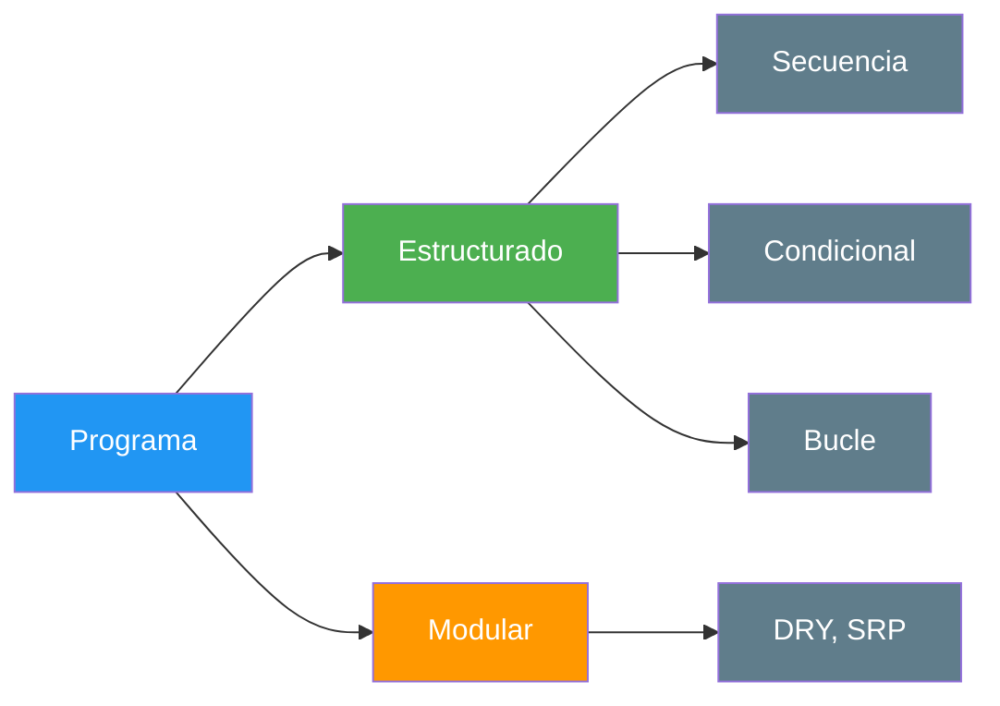

<div class="grid grid-cols-2 gap-4 mt-3 items-start">
<div>

**DRY**: si copias y pegas código, necesitas un **bucle** o un **módulo**.

</div>
<div>

**SRP**: cada módulo hace **una sola cosa**. Si hace dos, divídelo.

</div>
</div>

---

## Lo que ya sabes (UD01) y lo que vas a aprender (UD02)

<div class="grid grid-cols-2 gap-4 items-start">
<div>

| UD01 (lo que sabes) | UD02 (lo que aprenderás) |
|---------------------|--------------------------|
| Tipos de datos (`int`, `string`, `bool`) | Cómo pasarlos a funciones de forma segura |
| Variables y constantes | Ámbito: dónde vive cada variable |
| Entrada por consola (`ReadLine`) | `TryParse` para convertir de forma segura |
| Operadores aritméticos y lógicos | Condicionales complejos (`if-else`, `switch`) |
| Paradigmas de programación | Profundizar en estructurado y modular |

</div>
<div>

<RealExample app="Instagram">

Lee tu nombre (string), tu edad (int) y tu email (string). En UD01 solo sabías mostrarlos. En UD02 aprenderás a pasarlos a funciones que **validen, calculen y tomen decisiones** con esos datos.

</RealExample>

<TipBox type="nota">

Esta unidad usa **C# 14** sobre **.NET 10**, con `LangVersion` 14 en el `.csproj`.

</TipBox>

</div>
</div>

---

## ¿Qué aprenderás en esta unidad?

<div class="grid grid-cols-2 gap-4 items-start">
<div>

- **Escribir código claro** usando secuencias, condicionales y bucles
- **Tomar decisiones** con `if-else`, `switch` y el operador ternario
- **Repetir tareas** con `while`, `for` y `do-while`
- **Dividir problemas** en funciones y procedimientos reutilizables
- **Pasar datos de forma segura** con `ref`, `out` e `in`
- **Manejar errores** con `try-catch-finally` y `throw`
- **Depurar código** con aserciones

</div>
<div>

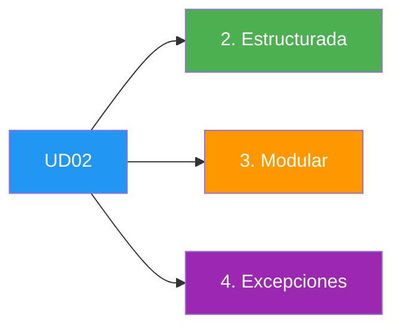

</div>
</div>

---

## Resumen del punto 1

<div class="grid grid-cols-2 gap-5 items-start">
<div>

| Concepto | Definición |
|----------|------------|
| **Paradigma** | Estilo de programar: aquí, estructurado + modular |
| **Estructurada** | Solo secuencia, condicional y bucle |
| **Modular** | Código dividido en funciones y procedimientos |
| **Código espagueti** | Maraña de `goto`: lo que hay que evitar |
| **DRY** | No repitas código: necesitas un bucle o un módulo |
| **SRP** | Un módulo, una única responsabilidad |
| **UD01 → UD02** | Tipos y variables → decisiones y módulos |

</div>
<div>

<ConceptCard icon="✅" title="Buenas prácticas" accent="green">

- Usa solo las **tres estructuras de control**
- Evita el `goto`: nunca hace falta
- Aplica **DRY** desde el primer día
- Un módulo = una responsabilidad (**SRP**)

</ConceptCard>

<div class="mt-3">

**⏭️ ¿Qué viene después?** En el **punto 2** vemos la **programación estructurada**: secuencias, condicionales y bucles.

</div>

</div>
</div>

---
layout: section
---

<div class="ud-section-number">02</div>

# Programación estructurada

<div class="opacity-70">Secuencias, condicionales y bucles</div>

---

## 2 · Punto de partida

<div class="grid grid-cols-2 gap-5 items-start">
<div>

<Objetivos
  :items="[
    'Entender el Teorema de la Programación Estructurada',
    'Usar condicionales (`if-else`, `switch`, ternario) para decidir',
    'Implementar bucles (`while`, `for`, `do-while`) para repetir',
    'Controlar el flujo de bucles con `break` y `continue`',
    'Programar simuladores con banderas y azar',
    'Depurar código con aserciones y técnicas del IDE',
  ]"
/>

</div>
<div>

<TipBox type="consejo" title="Punto de partida">

¿Has jugado a un videojuego con decisiones? En The Witcher, cada elección que tomas abre un camino diferente. Los condicionales son eso: **tu programa elige qué camino seguir**. Y los bucles son como las misiones repetitivas: «mata 10 lobos» = repite 10 veces la misma acción.

</TipBox>

</div>
</div>

---

## El teorema de la programación estructurada

<div class="grid grid-cols-2 gap-4 items-start">
<div>

Cualquier programa «propio» (un único punto de entrada y salida, sin bucles infinitos) puede escribirse usando **únicamente** estas tres estructuras:

- **Secuencia**: una instrucción detrás de otra
- **Condicional**: elegir un camino según una condición
- **Bucle**: repetir mientras se cumpla una condición

</div>
<div>

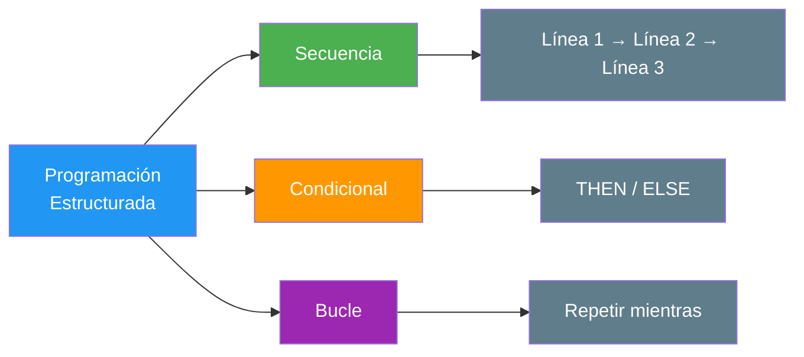

</div>
</div>

<TipBox type="consejo">

Con las tres estructuras **no necesitas `goto`**: el código es predecible y fácil de depurar. Como las piezas de Lego: con tres tipos de pieza construyes cualquier cosa.

</TipBox>

---

## Las tres estructuras, en un solo programa

```csharp
Console.Write("Introduce tu edad: ");
int.TryParse(Console.ReadLine(), out int edad);   // Secuencia

if (edad >= 18)                                  // Condicional
    Console.WriteLine("Eres mayor de edad.");
else
    Console.WriteLine("Eres menor de edad.");

for (int i = 1; i <= 3; i++)                      // Bucle
    Console.WriteLine($"Intento {i}");
```

<div class="grid grid-cols-3 gap-3 mt-3">

<ConceptCard icon="📏" title="Secuencia" accent="green">Instrucciones una detrás de otra.</ConceptCard>
<ConceptCard icon="🔀" title="Condicional" accent="yellow">Una condición decide qué bloque se ejecuta.</ConceptCard>
<ConceptCard icon="🔁" title="Bucle" accent="blue">Repite un bloque mientras se cumpla la condición.</ConceptCard>

</div>

---

## Secuencia: la estructura más simple

<div class="grid grid-cols-2 gap-5 items-start">
<div>

El programa ejecuta las instrucciones **de arriba hacia abajo**, una por una. Sin saltos ni repeticiones.

```csharp
Console.Write("¿Cómo te llamas? ");
string nombre = Console.ReadLine();

Console.Write("¿Cuántos años tienes? ");
int.TryParse(Console.ReadLine(), out int edad);

Console.WriteLine($"Hola {nombre}, tienes {edad} años.");
```

</div>
<div>


<RealExample app="Netflix">

Cuando abres Netflix: primero carga tu perfil (línea 1), luego muestra el catálogo (línea 2), después reproduce el vídeo seleccionado (línea 3). Es una secuencia perfecta.

</RealExample>

</div>
</div>

---

## Condicional simple (`if`)

<div class="grid grid-cols-2 gap-5 items-start">
<div>

Evalúa una condición booleana. Si es `true`, ejecuta el bloque de código; si es `false`, **no hace nada** y sigue.

```csharp
Console.Write("Introduce tu edad: ");
int.TryParse(Console.ReadLine(), out int edad);

if (edad >= 18)
{
    Console.WriteLine("Eres mayor de edad. Puedes votar.");
}
// Si edad < 18, simplemente no hace nada y continúa
```

</div>
<div>

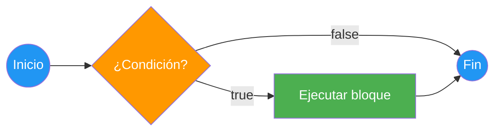

<RealExample app="YouTube">

Usa `if` para comprobar si tienes Premium: si es `true`, reproduce sin anuncios; si es `false`, muestra un anuncio primero.

</RealExample>

</div>
</div>

---

## Condicional compuesto (`if-else`)

<div class="grid grid-cols-2 gap-5 items-start">
<div>

Ejecuta un bloque si se cumple la condición y **otro bloque** si no se cumple. Los dos caminos son excluyentes: nunca ambos.

```csharp
Console.Write("Introduce tu edad: ");
int.TryParse(Console.ReadLine(), out int edad);

if (edad >= 18)
{
    Console.WriteLine("Eres mayor de edad.");
}
else
{
    Console.WriteLine("Eres menor de edad.");
}
```

</div>
<div>

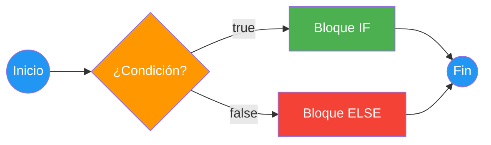

<RealExample app="Spotify">

Decide si reproduce en calidad alta o normal: si eres premium → calidad alta; si no → calidad normal. **Nunca ambas a la vez.**

</RealExample>

</div>
</div>

---

## Condicionales múltiples (`if-else if-else`)

<div class="grid grid-cols-2 gap-5 items-start">
<div>

Permite encadenar varias condiciones. Evalúa **en orden** y ejecuta la **primera que sea verdadera**.

```csharp
Console.Write("Introduce tu nota (0-10): ");
double.TryParse(Console.ReadLine(), out double nota);

if (nota >= 9)      Console.WriteLine("Sobresaliente");
else if (nota >= 7) Console.WriteLine("Notable");
else if (nota >= 5) Console.WriteLine("Aprobado");
else                Console.WriteLine("Suspenso");
```

</div>
<div>

<TipBox type="advertencia">

**El orden importa**: si pones `if (nota >= 5)` antes que `if (nota >= 9)`, nunca llegarás al sobresaliente (el 9 cumple también `>= 5`). Evalúa **de mayor a menor**.

</TipBox>

<RealExample app="Amazon">

Clasifica tus compras: si el gasto > 1000 € → cliente VIP; si > 500 € → preferente; si > 100 € → normal; si no → cliente nuevo.

</RealExample>

</div>
</div>

---

## `switch`: una variable contra muchos valores

<div class="grid grid-cols-2 gap-4 items-start">
<div>

```csharp
switch (dia)
{
    case 1: nombreDelDia = "Lunes"; break;
    case 2: nombreDelDia = "Martes"; break;
    case 3: nombreDelDia = "Miércoles"; break;
    case 4: nombreDelDia = "Jueves"; break;
    case 5: nombreDelDia = "Viernes"; break;
    case 6:
    case 7: nombreDelDia = "Fin de semana"; break;
    default: nombreDelDia = "Día inválido"; break;
}
```

<TipBox type="advertencia">

Cada `case` **debe** terminar con `break` (o `return`, `throw`). En C# no hay «caída» automática: los `case` vacíos se apilan (`case 6:` y `case 7:`).

</TipBox>

</div>
<div>

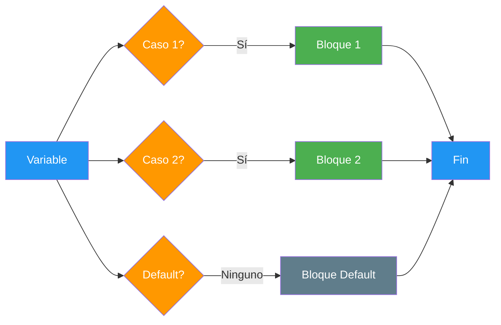

</div>
</div>

---

## Expresión `switch` moderna (C# 8+)

C# permite escribir `switch` como una **expresión** que devuelve un valor. Es más concisa:

<div class="grid grid-cols-2 gap-5 items-start">
<div>

```csharp
string nombreDelDia = dia switch
{
    1 => "Lunes",
    2 => "Martes",
    3 => "Miércoles",
    4 => "Jueves",
    5 => "Viernes",
    6 or 7 => "Fin de semana",
    _ => "Día inválido"   // _ es el default
};

Console.WriteLine($"Hoy es: {nombreDelDia}");
```

</div>
<div>

<TipBox type="nota">

`=>` es el operador de la expresión `switch`. El guion bajo `_` es el caso por defecto: «cualquier otro valor».

</TipBox>

<TipBox type="truco" title="Truco">

Usa `switch` cuando compares una **variable contra valores concretos**. Usa `if-else if` cuando las condiciones sean **expresiones complejas** (rangos, operadores lógicos).

</TipBox>

</div>
</div>

---

## Control de nulos: comparar con `null`

Trabajar con `null` es inevitable en C#. La forma **clásica** usa `!= null` y `== null`:

<div class="grid grid-cols-2 gap-5 items-start">
<div>

```csharp
string? nombre = null;

if (nombre != null)
{
    Console.WriteLine($"Hola, {nombre}");
}
else
{
    Console.WriteLine("Nombre no proporcionado");
}
```

</div>
<div>

**La forma moderna: `is null` e `is not null`**

```csharp
if (nombre is not null)
{
    Console.WriteLine($"Hola, {nombre}");   // Seguro: no es null
}
else
{
    Console.WriteLine("Nombre no proporcionado");
}
```

<TipBox type="consejo">

`is not null` es preferible a `!= null` porque funciona correctamente con la sobrecarga de operadores y con el *pattern matching*.

</TipBox>

</div>
</div>

---

## Resumen: cuándo usar cada comprobación de nulos

<div class="grid grid-cols-2 gap-4 items-start">
<div>

| Expresión | Cuándo usarla |
|-----------|---------------|
| `x != null` | Forma clásica, siempre funciona |
| `x is null` | Alternativa moderna a `== null` |
| `x is not null` | **Preferido** a `!= null` |
| `x is { } y` | Comprueba no-null + extrae en `y` |
| `x is string s` | Comprueba tipo + extrae |
| `x ?? default` | Si es null, usa valor por defecto |

</div>
<div>

<TipBox type="nota">

`x ?? default` es la forma más corta de **asignar un valor por defecto**: si la variable es `null`, se usa el de la derecha.

</TipBox>

<RealExample app="Netflix">

Usa `is not null` para comprobar si un usuario tiene suscripción antes de mostrar contenido premium. Si la suscripción es `null`, muestra «suscríbete» en vez de intentar acceder a datos inexistentes.

</RealExample>

</div>
</div>

---

## Pattern matching: `is { }` para extraer el valor

Cuando una variable puede ser `null` y necesitas usarla, `is { }` comprueba que **no es null** **y** la extrae en una nueva variable:

<div class="grid grid-cols-2 gap-5 items-start">
<div>

```csharp
string? nombre = ObtenerNombre();

// Forma clásica (verbosa)
if (nombre != null)
{
    string nombreLimpio = nombre.Trim();
    Console.WriteLine(nombreLimpio);
}

// Con is { } (limpio: comprueba no-null + extrae)
if (nombre is { } nombreLimpio)
{
    Console.WriteLine(nombreLimpio.Trim());
}
```

</div>
<div>

<TipBox type="nota">

Con `is { }` el compilador **sabe** que dentro del bloque la variable no es `null`: por eso te deja llamar a `.Trim()` sin miedo.

</TipBox>

<TipBox type="nota">

También puedes usar el patrón `<nombre de variable>` con el mismo nombre: `nombre is { } nombre`.

</TipBox>

</div>
</div>

---

## Pattern matching: `is string texto` para comprobar el tipo

Cuando el dato es de tipo `object`, puedes comprobar el tipo **y** extraerlo con el mismo patrón:

<div class="grid grid-cols-2 gap-5 items-start">
<div>

```csharp
object dato = ObtenerDato();

// Comprueba que es string Y lo extrae en "texto"
if (dato is string texto)
{
    Console.WriteLine($"Es un string: {texto.ToUpper()}");
}

// Comprueba que es un número entero
if (dato is int numero)
{
    Console.WriteLine($"Es un entero: {numero * 2}");
}
```

</div>
<div>

<TipBox type="nota">

El patrón `is <tipo> <variable>` es un **cast seguro**: si la comprobación falla, el bloque ni siquiera se ejecuta.

</TipBox>

<TipBox type="consejo">

Este patrón es la base del `switch` sobre tipos y de todo el *pattern matching* moderno de C#.

</TipBox>

</div>
</div>

---

## Condiciones complejas: agrúpalas con paréntesis

Una de las técnicas más útiles para evitar errores en los condicionales es usar **paréntesis** para agrupar condiciones complejas:

<div class="grid grid-cols-2 gap-5 items-start">
<div>

```csharp
int edad = 20;
bool tieneDNI = true;

if ((edad >= 18) && (tieneDNI))
{
    Console.WriteLine("Puedes votar.");
}
else
{
    Console.WriteLine("No puedes votar.");
}
```

</div>
<div>

<TipBox type="consejo">

Los paréntesis no son obligatorios en C#, pero **evitan la duda**: con ellos, cualquier lector (y tú dentro de tres meses) sabe exactamente qué se evalúa.

</TipBox>

<TipBox type="advertencia">

Un condicional malagrupado **no avisa al compilar**: es de los errores más peligrosos que existen.

</TipBox>

</div>
</div>

---

## Operador ternario `? :`

Como viste en la UD01, el operador ternario es una forma **reducida** del `if-else` que devuelve un valor.

<div class="grid grid-cols-2 gap-5 items-start">
<div>

```csharp
int edad = 20;

// Con if-else (verboso)
string mensaje;
if (edad >= 18)
{
    mensaje = "Mayor de edad";
}
else
{
    mensaje = "Menor de edad";
}

// Con ternario (conciso)
string mensaje2 = edad >= 18 ? "Mayor de edad" : "Menor de edad";

Console.WriteLine(mensaje2);   // Mayor de edad
```

</div>
<div>

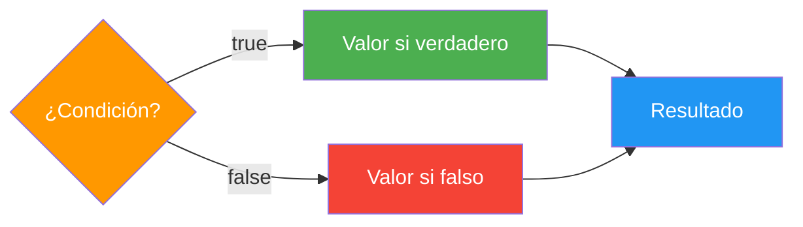

<TipBox type="consejo">

Usa el ternario cuando la asignación sea simple (una línea). Si la lógica es compleja, usa `if-else` normal.

</TipBox>

</div>
</div>

---

## Operador de coalescencia `??`

`??` proporciona un **valor por defecto** si una variable es `null`. Es como un `if` compacto para la nulidad:

<div class="grid grid-cols-2 gap-5 items-start">
<div>

```csharp
string? nombre = null;

// Con if-else
string nombreSeguro;
if (nombre != null)
{
    nombreSeguro = nombre;
}
else
{
    nombreSeguro = "Desconocido";
}

// Con ?? (conciso)
string nombreSeguro2 = nombre ?? "Desconocido";

Console.WriteLine(nombreSeguro2);   // Desconocido
```

</div>
<div>

<RealExample app="Netflix">

Usa `??` para mostrar «Sin descripción» cuando una serie no tiene sinopsis: `sinopsis ?? "Sin descripción"`.

</RealExample>

<TipBox type="nota">

`??` es, en el fondo, un ternario rápido para la nulidad: `nombre != null ? nombre : "Desconocido"`.

</TipBox>

</div>
</div>

---

## Operador de asignación nula `??=`

También existe `??=`, que asigna un valor **solo si** la variable es `null`:

<div class="grid grid-cols-2 gap-5 items-start">
<div>

```csharp
string? nombre = null;

nombre ??= "Visitante";   // Si es null, asigna "Visitante"
Console.WriteLine(nombre); // Visitante

nombre ??= "Otro";        // Ya no es null, no cambia
Console.WriteLine(nombre); // Sigue siendo Visitante
```

</div>
<div>

<TipBox type="nota">

`??=` es una forma compacta de escribir `if (nombre == null) nombre = "Visitante";`.

</TipBox>

<TipBox type="truco">

Perfecto para poner **valores por defecto** en la inicialización de una variable sin ensuciar el código.

</TipBox>

</div>
</div>

---

## Bucle `while`

<div class="grid grid-cols-2 gap-5 items-start">
<div>

Evalúa la condición **antes** de cada iteración. Si la condición es `false` al inicio, **nunca se ejecuta**.

```csharp
int contador = 0;
while (contador < 5)
{
    Console.WriteLine($"Contador: {contador}");
    contador++;   // ¡Importante! Sin esto, bucle infinito
}
// Salida: 0, 1, 2, 3, 4
```

</div>
<div>

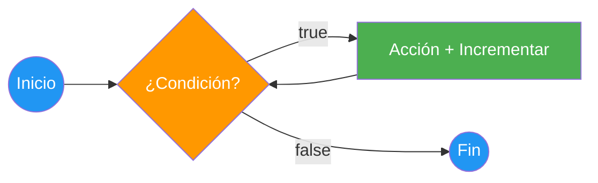

<RealExample app="TikTok">

Usa bucles para cargar tu feed: mientras haya vídeos nuevos, los muestra uno tras otro. Cuando te quedas sin contenido, el bucle para.

</RealExample>

</div>
</div>

---

## Bucle `do-while`

Evalúa la condición **después** de cada iteración. Garantiza **al menos una ejecución**.

<div class="grid grid-cols-2 gap-5 items-start">
<div>

```csharp
string opcion;

do
{
    Console.WriteLine("=== MENÚ ===");
    Console.WriteLine("1. Ver perfil");
    Console.WriteLine("2. Salir");
    Console.Write("Opción: ");
    opcion = Console.ReadLine();
} while (opcion != "2");

Console.WriteLine("¡Hasta luego!");
```

</div>
<div>

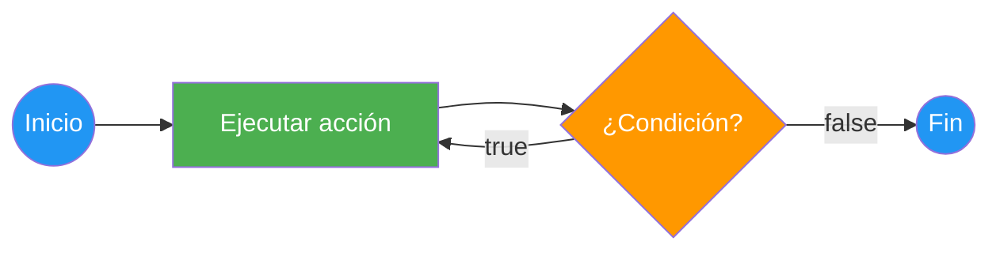

<TipBox type="consejo">

`do-while` es perfecto para **menús**: siempre quieres mostrar el menú al menos una vez, sin importar qué elija el usuario.

</TipBox>

</div>
</div>

---

## Bucle `for`

<div class="grid grid-cols-2 gap-5 items-start">
<div>

```csharp
// Ascendente: de 0 a 5
for (int i = 0; i <= 5; i++)
{
    Console.WriteLine(i);      // 0, 1, 2, 3, 4, 5
}

// De 2 en 2
for (int i = 0; i <= 10; i += 2)
{
    Console.WriteLine(i);      // 0, 2, 4, 6, 8, 10
}
```

</div>
<div>

<TipBox type="truco" title="Truco nemotécnico">

- **`for`** = **F**ijo → sabes cuántas veces
- **`while`** = **W**hile → mientras se cumpla, repite
- **`do-while`** = **D**o → hacer al menos una vez

</TipBox>

<TipBox type="nota">

El `for` no es solo para contar: es el bucle natural para **recorrer colecciones** (lo verás en la UD03 con los arrays).

</TipBox>

</div>
</div>

---

## ¿Cuál elijo? La comparativa

<div class="grid grid-cols-2 gap-5 items-start">
<div>

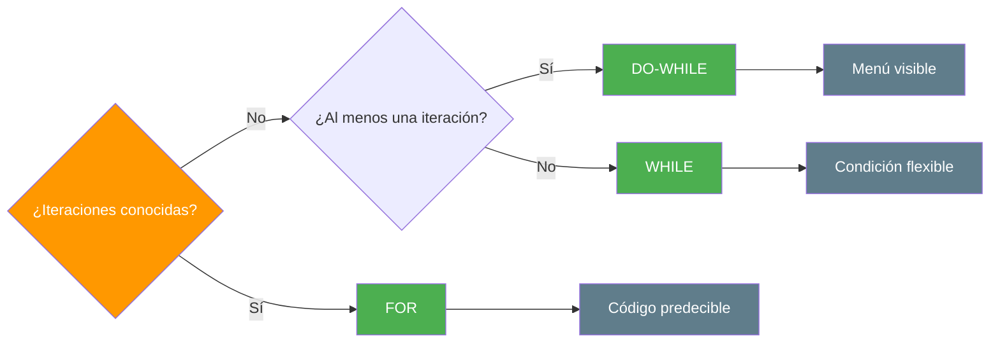

</div>
<div>

| Bucle | Evalúa la condición | Iteraciones mínimas |
|-------|--------------------|---------------------|
| `while` | **Antes** | 0 (puede no ejecutarse) |
| `do-while` | **Después** | 1 (siempre una) |
| `for` | Antes (todo junto) | 0 |

<TipBox type="nota">

`while` = «mientras», `do-while` = «haz y luego comprueba», `for` = «para cada elemento».

</TipBox>

</div>
</div>

---

## Bucles controlados por indicadores (banderas o flags)

Las **banderas** son variables booleanas (`bool`) que controlan la ejecución del bucle.

<div class="grid grid-cols-2 gap-5 items-start">
<div>

```csharp
// Determinar si un número contiene solo cifras menores que 5
bool menor;
int num;

Console.Write("Introduce un número: ");
int.TryParse(Console.ReadLine(), out num);

menor = true;   // Inicialización del indicador

while (menor && (num > 0))
{
    if (num % 10 >= 5)
    {
        menor = false;   // Cambiamos la bandera
    }
    num = num / 10;      // Eliminamos la última cifra
}
```

</div>
<div>

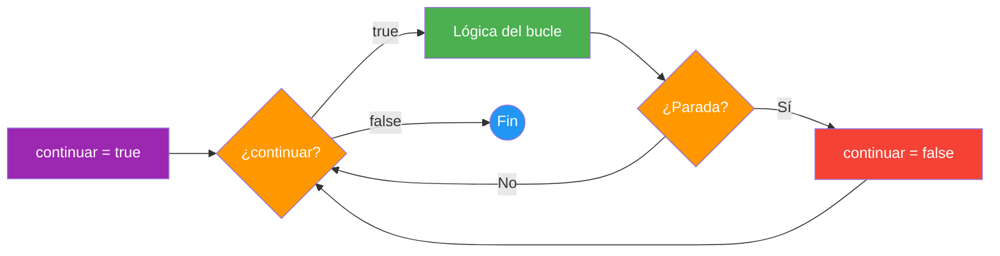

<TipBox type="nota">

La bandera se **inicializa antes** del bucle, se **reevalúa dentro** y se **lee en la condición de salida**.

</TipBox>

</div>
</div>

---

## Bucles controlados por centinela

Un **centinela** es un valor especial que indica la parada de la iteración.

<div class="grid grid-cols-2 gap-5 items-start">
<div>

```csharp
// Sumar números hasta que se introduce 0 (centinela)
int suma = 0;
int num;

Console.Write("Introduce números a sumar, 0 para acabar: ");
int.TryParse(Console.ReadLine(), out num);

while (num != 0)
{
    suma += num;
    Console.Write("Introduce números a sumar, 0 para acabar: ");
    int.TryParse(Console.ReadLine(), out num);
}

Console.WriteLine($"Suma total: {suma}");
```

</div>
<div>

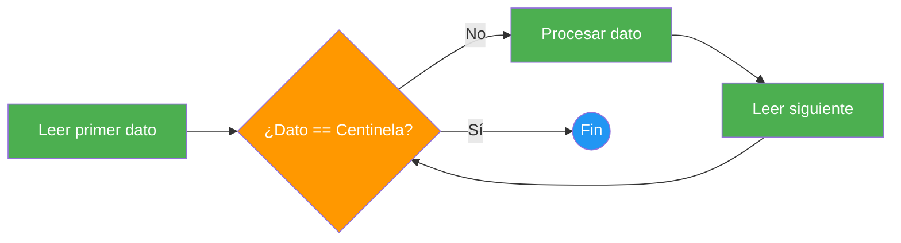

<TipBox type="truco">

El centinela debe ser un valor **imposible** como dato válido: por eso el `0` en «sumar hasta 0» y el `-1` en «notas hasta -1».

</TipBox>

</div>
</div>

---

## Bucles anidados

Los bucles se pueden **anidar** (un bucle dentro de otro). Especialmente útil para matrices.

<div class="grid grid-cols-2 gap-5 items-start">
<div>

```csharp
// Generar tabla de multiplicar (1 a 10)
for (int i = 1; i <= 10; i++)
{
    for (int j = 1; j <= 10; j++)
    {
        Console.Write($"{i * j,4}");
    }
    Console.WriteLine();
}
```

</div>
<div>

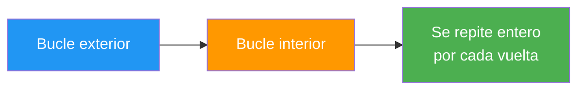

<TipBox type="nota">

El bucle **interior** se ejecuta **completo** por cada vuelta del exterior: 10 × 10 = 100 iteraciones.

</TipBox>

</div>
</div>

---

## Sentencia de salto: `break`

`break` **sale completamente** del bucle más cercano. Se usa cuando se ha encontrado lo que buscabas.

<div class="grid grid-cols-2 gap-5 items-start">
<div>

```csharp
// Buscar un dígito concreto, por ejemplo el 7 en 5723
int numero = 5723;

while (numero > 0)
{
    int digito = numero % 10;   // último dígito

    if (digito == 7)
    {
        Console.WriteLine("¡Encontrado un 7!");
        break;                  // No necesitamos seguir buscando
    }

    numero = numero / 10;       // quitamos el último dígito
}
// Salida: ¡Encontrado un 7!
```

</div>
<div>

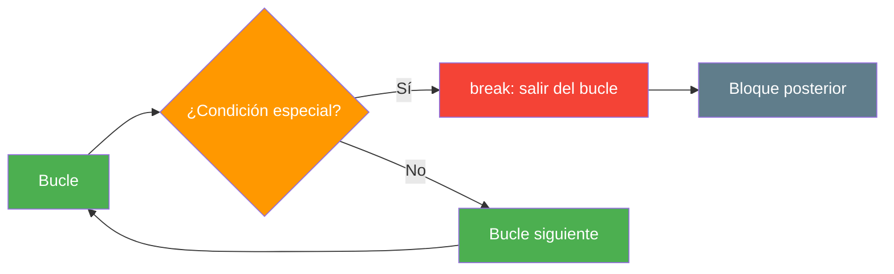

<TipBox type="nota">

`break` solo sale del bucle **más cercano**: si hay bucles anidados, se sale solo del interior.

</TipBox>

</div>
</div>

---

## Sentencia de salto: `continue`

`continue` **salta** a la siguiente iteración del bucle, sin ejecutar el código que queda en la iteración actual.

<div class="grid grid-cols-2 gap-5 items-start">
<div>

```csharp
// Mostrar solo números pares
for (int i = 1; i <= 10; i++)
{
    if (i % 2 != 0)
    {
        continue;   // Saltar impares
    }
    Console.WriteLine($"{i} es par");
}
// Salida: 2 es par, 4 es par, 6 es par, 8 es par, 10 es par
```

</div>
<div>

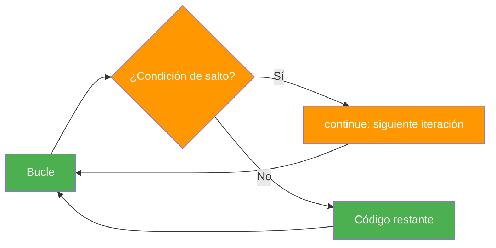

<TipBox type="advertencia">

Usa `break` y `continue` con moderación. Si tu bucle necesita muchos, probablemente necesite **reestructurarse**.

</TipBox>

</div>
</div>

---

## Peligros: el bucle infinito

<div class="grid grid-cols-2 gap-5 items-start">
<div>

```csharp
// ❌ ERROR: olvidaste incrementar
int contador = 0;
while (contador < 10)
{
    Console.WriteLine(contador);
    // contador NUNCA cambia → bucle infinito
}

// ❌ ERROR: condición siempre verdadera
while (true) { /* ... */ }
```

</div>
<div>

```csharp
// ❌ ERROR: condición que nunca se cumple
int opcion = 0;
while (opcion == 5) { /* ... */ }

// ✅ CORRECTO
int contador = 0;
while (contador < 10)
{
    Console.WriteLine(contador);
    contador++;   // ¡Importante!
}
```

<TipBox type="consejo">

Antes de ejecutar un bucle, hazte la pregunta: **«¿Cómo sale este bucle?»** Si no tienes respuesta, tienes un bucle infinito.

</TipBox>

</div>
</div>

---

## Números aleatorios (`Random`)

<div class="grid grid-cols-2 gap-5 items-start">
<div>

```csharp
Random rnd = new();   // Un SOLO generador, reutilízalo

int dado = rnd.Next(1, 7);   // Entre 1 y 6 (¡el 7 NO sale!)
int num = rnd.Next(10);      // Forma corta: entre 0 y 9
double p = rnd.NextDouble(); // Decimal entre 0.0 y 1.0

// La receta habitual para simular probabilidades
bool ocurre = rnd.NextDouble() < 0.20;   // 20 % de probabilidad
```

</div>
<div>

<TipBox type="advertencia">

`Next(min, max)` es **exclusivo en el máximo**: `Next(1, 7)` jamás devuelve un 7. Para incluirlo, escribe `Next(1, 8)`.

</TipBox>

<TipBox type="consejo">

Crea el `Random` **una sola vez** y reutilízalo en todo el programa.

</TipBox>

</div>
</div>

<RealExample app="Tragaperras">

Genera sus tres rodillos con `rnd.Next(0, 10)` (números del 0 al 9) y un simulador decide si un proceso termina antes con `rnd.NextDouble() < 0.20`.

</RealExample>

---

## Simuladores: la lógica

<div class="grid grid-cols-2 gap-5 items-start">
<div>

La clave es que **no sabes de antemano cuántos ciclos hará falta**: por eso se programa con un bucle cuya salida depende de que «algo» ocurra.

Ese «algo» puede ser:

- un **contador** que llega a su máximo (se acabó el tiempo)
- una **bandera** que se enciende (el azar dice «basta»)
- una **decisión del usuario** (quiso salir)

</div>
<div>

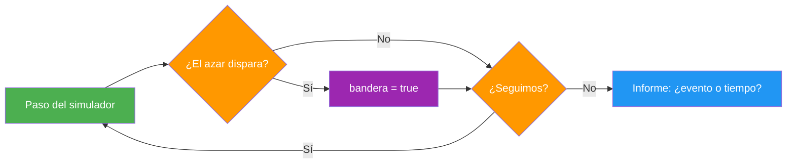

<TipBox type="analogia">

Un simulador es como calentar café en el microondas: pones el tiempo (tope), calienta segundo a segundo y en cada segundo puede pasar algo. El microondas no sabe cuántos segundos hará falta: comprueba **después** de cada segundo.

</TipBox>

</div>
</div>

---

## `while` o `do-while`: el rey de los simuladores

Casi siempre se combinan: *«esto será así **hasta que** se acabe el tiempo **o** hasta que ocurra lo que tenga que ocurrir»*.

<div class="grid grid-cols-2 gap-5 items-start">
<div>

En un simulador, el **`do-while` casi siempre es el rey**: el proceso debe avanzar al menos un ciclo antes de preguntar si sigue.

El `while` lo reservas para cuando el simulador puede ni siquiera arrancar (por ejemplo, si el usuario empieza sin saldo).

```csharp
// do-while: el proceso avanza siempre al menos un ciclo
do
{
    // un paso del simulador
} while (tiempo < maximo && !terminado);
```

</div>
<div>

<TipBox type="truco" title="Truco">

**¿Y si el proceso puede no arrancar?** Entonces el `while` es tu amigo: si la condición es falsa de entrada, el bucle no se ejecuta ni una vez.

</TipBox>

<TipBox type="consejo">

El esqueleto universal es: (1) el contador del tiempo, (2) la bandera del evento, (3) el `do-while` con las dos condiciones, (4) el `if` final que informa del desenlace.

</TipBox>

</div>
</div>

---

## El reloj del simulador: `Thread.Sleep`

<div class="grid grid-cols-2 gap-5 items-start">
<div>

```csharp
// Un reloj de consola: 5 segundos contados uno a uno
for (int s = 1; s <= 5; s++)
{
    Thread.Sleep(1000);              // Pausa REAL de 1 segundo
    Console.WriteLine($"Han pasado {s} segundo(s)");
}
```

Sin la línea del `Sleep`, los cinco mensajes se imprimen de golpe en un destello.

</div>
<div>

<TipBox type="advertencia">

`Thread.Sleep` detiene el hilo por completo: mientras duerme, el programa no hace nada más. En una app con interfaz gráfica eso «congelaría» la ventana (ahí se usan temporizadores).

</TipBox>

<RealExample app="Videojuegos">

Los juegos usan el mismo patrón en su *game loop*: para mantener 60 imágenes por segundo, cada ciclo espera los ~16 milisegundos que faltan antes de dibujar el siguiente fotograma.

</RealExample>

</div>
</div>

---

## Banderas: la memoria del simulador

<div class="grid grid-cols-2 gap-5 items-start">
<div>

Toda bandera tiene cuatro momentos, y si olvidas uno, el simulador se rompe:

```csharp
const int maximo = 10000;
int tiempo = 0;
bool terminado = false;     // 1. Se inicializa ANTES

do
{
    tiempo += 1000;                        // ... un paso ...
    terminado = Probabilidad(0.20);  // 2. Se reevalúa DENTRO
} while (tiempo < maximo && !terminado);   // 3. Se lee al salir

if (terminado)                    // 4. Distingue el desenlace
{
    Console.WriteLine("Terminó por azar");
}
```

</div>
<div>

<TipBox type="advertencia">

El error clásico es olvidar el **paso 2**: la bandera se inicializa en `false` y **nadie la cambia nunca**, así que el bucle solo puede salir por el contador (o no sale nunca).

</TipBox>

<TipBox type="truco" title="Truco">

Nómbralas como una pregunta o con «ha...»: `terminado`, `haFallado`, `salioPorAzar`. Al leer `while (!haFallado)` se entiende sola.

</TipBox>

</div>
</div>

---

## El simulador: el estado y las constantes

Vamos a montar uno completo: un proceso que avanza en pasos de 1 segundo durante un máximo de 10 segundos, y que en cada paso tiene un 20 % de probabilidad de terminar antes por azar. Primero, el estado:

<div class="grid grid-cols-2 gap-5 items-start">
<div>

```csharp
const int TIEMPO_SIMULACION = 10000;      // Duración máxima (ms)
const int INCREMENTO_TIEMPO = 1000;  // Cada tick: 1 segundo
const decimal PROBABILIDAD_ACCION = 0.20m; // 20 % por tick

int tiempo = 0;                 // El "reloj" del simulador
bool salidaPorProbabilidad = false;      // LA BANDERA del azar
Random rnd = new();   // Un único generador
```

</div>
<div>

<TipBox type="nota">

Fíjate en el nombre de la bandera: no es `terminado`, sino `salidaPorProbabilidad`, porque no marca solo que acabó, sino **por qué**.

</TipBox>

<TipBox type="consejo">

Un simulador se escribe **en papel primero**: qué empieza, qué cambia en cada vuelta y qué hace terminar el bucle.

</TipBox>

</div>
</div>

---

## El simulador: el bucle y el desenlace

Ahora el corazón del simulador: el bucle `do-while` con sus dos condiciones de parada:

<div class="grid grid-cols-2 gap-5 items-start">
<div>

```csharp
do
{
    Thread.Sleep(INCREMENTO_TIEMPO); // Pausa real de 1 segundo
    tiempo += INCREMENTO_TIEMPO;     // Avanzamos un ciclo
    Console.WriteLine($"Tiempo: {tiempo}");

    // El azar vota
    salidaPorProbabilidad = Probabilidad(PROBABILIDAD_ACCION);
}
while (tiempo < TIEMPO_SIMULACION && !salidaPorProbabilidad);

if (salidaPorProbabilidad)
    Console.WriteLine("Se ha salido por probabilidad");
else
    Console.WriteLine("Se ha llegado al tiempo de simulación");
```

</div>
<div>

```csharp
// El azar encapsulado en una función (¡programación modular!)
bool Probabilidad(decimal probabilidad)
{
    return (decimal)rnd.NextDouble() < probabilidad;
}
```

<TipBox type="nota">

Esa función `Probabilidad` es **programación modular**: la aleatoriedad encapsulada en un módulo con una sola responsabilidad. Lo ves en detalle en el punto 3.

</TipBox>

</div>
</div>

---

## Depuración: el depurador del IDE

<div class="grid grid-cols-2 gap-5 items-start">
<div>

1. Pone un **punto de interrupción** (breakpoint) en la línea sospechosa
2. Ejecuta en modo depuración
3. Inspecciona el valor de las variables en tiempo real
4. Avanza línea a línea (`Step Over`) o entra en funciones (`Step Into`)

```csharp
for (int i = 0; i < 5; i++)
{
    int cuadrado = i * i;   // ← Al depurar ves i=0, cuadrado=0
    Console.WriteLine($"{i}² = {cuadrado}");
}
```

</div>
<div>

<RealExample app="Netflix">

Los desarrolladores de Netflix usan el depurador para encontrar por qué un vídeo se congela: ponen un breakpoint en el bucle de reproducción, inspeccionan la memoria y detectan que el buffer se llenó.

</RealExample>

<TipBox type="consejo">

Aprende a usar el depurador: es la herramienta más poderosa que tiene un programador. Más precisa que cualquier `Console.WriteLine`.

</TipBox>

</div>
</div>

---

## Depuración: impresión de mensajes

A veces no tienes depurador o es más rápido un `Console.WriteLine`:

<div class="grid grid-cols-2 gap-5 items-start">
<div>

```csharp
int numero = 5231;

while (numero > 0)
{
    int digito = numero % 10;
    Console.WriteLine($"DEBUG: num={numero}, dig={digito}");
    numero = numero / 10;
}
// Cada línea te muestra cómo va cambiando el número, paso a paso
```

</div>
<div>

<TipBox type="nota">

Escribe el mensaje con **todos los valores que te importan** en una sola línea: así de un vistazo ves el estado del programa en ese punto.

</TipBox>

<TipBox type="advertencia">

No te olvides de **borrar los mensajes de depuración** antes de entregar el código: en producción no println a media pantalla.

</TipBox>

</div>
</div>

---

## Aserciones (`Debug.Assert`)

Las **aserciones** verifican supuestos que deben ser **ciertos siempre** en un punto concreto del código. Si la condición es falsa, el programa **se detiene en desarrollo** y muestra el error.

<div class="grid grid-cols-2 gap-5 items-start">
<div>

```csharp
using System.Diagnostics;

int CalcularDescuento(int precio, int cantidad)
{
    Debug.Assert(precio >= 0, "El precio no es negativo");
    Debug.Assert(cantidad > 0, "La cantidad debe ser al menos 1");

    return precio * cantidad;
}
```

</div>
<div>

<TipBox type="nota">

`Debug.Assert` solo se ejecuta en compilación **Debug** (en `Release` desaparece, porque está marcada con `[Conditional("DEBUG")]`).

</TipBox>

<TipBox type="advertencia">

No validan datos de usuario (eso es el `if`): avisan de «esto no debería pasar jamás».

</TipBox>

</div>
</div>

---

## Resumen del punto 2

<div class="grid grid-cols-2 gap-5 items-start">
<div>

| Concepto | Descripción |
|----------|-------------|
| **Secuencia** | Instrucciones de arriba abajo |
| **`if` / `if-else` / `switch`** | Decidir; `switch` compara una variable |
| **Nulos** | `is not null`, `is { }`, `is string s` |
| **Ternario / `??` / `??=`** | `if` compacto para valores y nulos |
| **`while` / `do-while` / `for`** | Repetir; `for` si conoces las vueltas |
| **Bandera / centinela** | Controlar la salida del bucle |
| **`break` / `continue` / `Random`** | Saltos, azar y tiempo en los simuladores |

</div>
<div>

<ConceptCard icon="✅" title="Buenas prácticas" accent="green">

- Solo las **tres estructuras** de control
- Evalúa los `if` **de mayor a menor**
- Cada `case` con `break`
- `is not null` en vez de `!= null`
- Verifica la **condición de salida** del bucle

</ConceptCard>

<div class="mt-3">

**⏭️ ¿Qué viene después?** En el **punto 3**: **programación modular** — funciones, procedimientos y parámetros.

</div>

</div>
</div>

---
layout: section
---

<div class="ud-section-number">03</div>

# Programación modular

<div class="opacity-70">Funciones, parámetros y recursividad</div>

---

## 3 · Punto de partida

<div class="grid grid-cols-2 gap-5 items-start">
<div>

<Objetivos
  :items="[
    'Comprender qué es la programación modular y por qué es importante',
    'Diferenciar entre funciones (devuelven valor) y procedimientos (void)',
    'Dominar los modificadores de parámetros: `ref`, `out` e `in`',
    'Entender el ámbito de las variables (local vs. global)',
    'Aplicar la recursividad y el Early Return',
  ]"
/>

</div>
<div>

<TipBox type="consejo" title="Punto de partida">

¿Alguna vez has construido algo con LEGO? Cada pieza es pequeña, sencilla y tiene una función clara. Juntas construyen cualquier cosa. La programación modular es lo mismo: dividir un programa grande en piezas pequeñas, manejables y reutilizables.

</TipBox>

</div>
</div>

---

## Divide y vencerás (DAC)

La técnica fundamental de la **programación modular** es *«Divide y Vencerás»*.

<div class="grid grid-cols-2 gap-5 items-start">
<div>

**Pasos de la descomposición modular:**

1. **Análisis**: comprender el problema
2. **Identificación**: dividir en subproblemas
3. **Diseño**: crear módulos para cada subproblema
4. **Implementación**: codificar cada módulo
5. **Pruebas**: probar cada módulo individualmente

</div>
<div>

```mermaid
graph LR
    PROB[Problema grande] --> S1[Subproblema 1]
    PROB --> S2[Subproblema 2]
    PROB --> S3[Subproblema 3]
    S1 --> M1[Módulo 1]
    S2 --> M2[Módulo 2]
    S3 --> M3[Módulo 3]
    M1 --> SOL[Solución completa]
    M2 --> SOL
    M3 --> SOL

    style PROB fill:#f44336,color:#fff
    style S1 fill:#FF9800,color:#fff
    style S2 fill:#FF9800,color:#fff
    style S3 fill:#FF9800,color:#fff
    style M1 fill:#4CAF50,color:#fff
    style M2 fill:#4CAF50,color:#fff
    style M3 fill:#4CAF50,color:#fff
    style SOL fill:#2196F3,color:#fff
```

</div>
</div>

<TipBox type="consejo">

**SRP (Single Responsibility Principle):** cada módulo hace **una sola cosa**. Si no puedes describir una función en una frase corta **sin usar «y»**, divídela.

</TipBox>

---

## ¿Por qué dividir en módulos?

<div class="grid grid-cols-3 gap-3">

<ConceptCard icon="🔍" title="Claridad" accent="green">Cada módulo hace una cosa y la hace bien.</ConceptCard>
<ConceptCard icon="♻️" title="Reutilización" accent="blue">Una función puede usarse en muchos sitios.</ConceptCard>
<ConceptCard icon="🔧" title="Mantenimiento" accent="purple">Si hay un bug, solo arreglas un módulo.</ConceptCard>
<ConceptCard icon="👥" title="Trabajo en equipo" accent="yellow">Cada programador trabaja en módulos diferentes.</ConceptCard>
<ConceptCard icon="✅" title="Testing" accent="accent">Puedes probar cada módulo por separado.</ConceptCard>
<ConceptCard icon="🚀" title="Velocidad" accent="green">Si cambias una parte, no rompes el resto.</ConceptCard>

</div>

---

## Funciones: devuelven un valor

Una **función** realiza una tarea y **devuelve un resultado** mediante `return`.

<div class="grid grid-cols-2 gap-5 items-start">
<div>

```csharp
// Función que calcula el área de un rectángulo
double CalcularArea(double largo, double ancho)
{
    return largo * ancho;
}

// Uso
double area = CalcularArea(5.0, 3.0);
Console.WriteLine($"Área: {area}");   // Área: 15
```

</div>
<div>

```mermaid
graph LR
    A[Parámetros: largo, ancho] --> B[Función: CalcularArea]
    B --> C[return: resultado]
    C --> D[Variable: area]

    style A fill:#FF9800,color:#fff
    style B fill:#4CAF50,color:#fff
    style C fill:#2196F3,color:#fff
    style D fill:#9C27B0,color:#fff
```

<RealExample app="Spotify">

Tiene una función `CalcularDuracionPlaylist()` que recibe una lista de canciones y devuelve la duración total. Se llama cada vez que abres una playlist.

</RealExample>

</div>
</div>

---

## Procedimientos: no devuelven nada

<div class="grid grid-cols-2 gap-5 items-start">
<div>

```csharp
// Procedimiento que muestra un saludo
void Saludar(string nombre)
{
    Console.WriteLine($"¡Hola, {nombre}! Bienvenido.");
}

// Uso
Saludar("Ana");   // ¡Hola, Ana! Bienvenido.
```

</div>
<div>

| Característica | Función | Procedimiento |
|---------------|---------|---------------|
| **Tipo de retorno** | `int`, `double`... | `void` |
| **`return`** | Obligatorio | Opcional |
| **Uso típico** | Calcular, validar | Mostrar, guardar |

<TipBox type="nota">

En C# ambos se llaman **métodos**. La distinción función/procedimiento es conceptual para entender si devuelven o no un valor.

</TipBox>

</div>
</div>

---

## Función o procedimiento: el árbol

<div class="grid grid-cols-2 gap-5 items-start">
<div>

```mermaid
graph LR
    M[Método] --> F[Función]
    M --> P[Procedimiento]
    F --> FR[return con valor]
    P --> PV[void: no devuelve nada]

    style M fill:#2196F3,color:#fff
    style F fill:#4CAF50,color:#fff
    style P fill:#FF9800,color:#fff
    style FR fill:#607D8B,color:#fff
    style PV fill:#607D8B,color:#fff
```

</div>
<div>

<TipBox type="analogia">

Una **función** es una máquina expendedora: le das algo y te **devuelve** un producto. Un **procedimiento** es el archivador: le das algo y lo **guarda**, no te devuelve nada.

</TipBox>

<TipBox type="nota">

Cuando oigas «función» en un vídeo o en un libro, comprueba primero si devuelve valor: casi siempre se usa el término de forma informal.

</TipBox>

</div>
</div>

---

## Documenta tus funciones con XMLDoc

El XMLDoc que viste en la UD01 también le toca a tus funciones: con comentarios `///` (`summary`, `param` y `returns`) dejas constancia de qué hace cada función.

<div class="grid grid-cols-2 gap-5 items-start">
<div>

```csharp
/// <summary>
/// Calcula el descuento aplicable a una compra.
/// </summary>
/// <param name="total">Importe total de la compra.</param>
/// <param name="esPremium">Si el cliente es premium.</param>
/// <returns>El descuento aplicado en euros.</returns>
double CalcularDescuento(double total, bool esPremium)
{
    // Si es premium, 10% de descuento; si no, 5%
    return esPremium ? total * 0.10 : total * 0.05;
}
```

</div>
<div>

<TipBox type="advertencia">

Ojo con el `///` en el `Program.cs` con **Top-Level Statements**: ahí no hay dónde enganchar la documentación. Si el proyecto genera documentación, el compilador lanza el **error CS1587**.

</TipBox>

<TipBox type="nota">

Documentar es cosa de **quien escribe el código**, no de después. Y el XMLDoc está pensado para **métodos de objetos** (lo verás en la UD04).

</TipBox>

</div>
</div>

---

## Parámetros y argumentos

Los **parámetros** son las variables de la definición del método. Los **argumentos** son los valores reales que pasas al llamarlo.

<div class="grid grid-cols-2 gap-5 items-start">
<div>

```csharp
// "nombre" y "edad" son PARÁMETROS
void MostrarInfo(string nombre, int edad)
{
    Console.WriteLine($"{nombre} tiene {edad} años");
}

// "Ana" y 25 son ARGUMENTOS
MostrarInfo("Ana", 25);
```

</div>
<div>

<TipBox type="analogia">

El parámetro es el **hueco** de la máquina expendedora y el argumento es la **moneda** que metes. El hueco está definido de antemano; la moneda es lo que tú decides.

</TipBox>

<TipBox type="nota">

Para controlar **cómo** se pasan los datos existen los modificadores: `ref`, `out` e `in`. Vamos uno a uno.

</TipBox>

</div>
</div>

---

## Paso por valor (por defecto)

Cuando pasas un argumento **por valor**, la función recibe una **copia** del dato original. Cualquier modificación **no afecta** a la variable original.

<div class="grid grid-cols-2 gap-5 items-start">
<div>

```csharp
void Incrementar(int numero)
{
    numero = numero + 1;                      // Modifica la COPIA
    Console.WriteLine($"Dentro del método: {numero}");   // 11
}

int valorOriginal = 10;
Incrementar(valorOriginal);
Console.WriteLine($"Fuera: {valorOriginal}");   // Sigue siendo 10
```

</div>
<div>

```mermaid
graph LR
    A[Variable x = 10] -->|Copia del 10| B[Método]
    B -->|x = x + 1| C[Copia local es 11]
    C -.->|Fin del método| D[x original sigue 10]

    style A fill:#2196F3,color:#fff
    style B fill:#4CAF50,color:#fff
    style C fill:#FF9800,color:#fff
    style D fill:#2196F3,color:#fff
```

<TipBox type="analogia">

Es como darle a un amigo una **fotocopia** de tu trabajo para que lo revise. Él escribe notas al margen, tacha cosas... pero tu trabajo original **no cambia**.

</TipBox>

</div>
</div>

---

## Paso por referencia con `ref`

`ref` pasa la **dirección de memoria** de la variable. Cualquier cambio **modifica el original**.

<div class="grid grid-cols-2 gap-5 items-start">
<div>

```csharp
void Duplicar(ref int numero)
{
    numero = numero * 2;   // Modifica el original DIRECTAMENTE
}

int valorOriginal = 10;
Console.WriteLine($"Antes: {valorOriginal}");     // 10
Duplicar(ref valorOriginal);
Console.WriteLine($"Después: {valorOriginal}");   // 20
```

```csharp
void SinRef(int numero) { numero = 999; }    // Solo la copia
void ConRef(ref int numero)
{
    numero = 999;    // Cambia el original
}
```

</div>
<div>

```mermaid
graph LR
    A[Variable y = 10] -->|Referencia a y| B[Método]
    B -->|y = y + 1| C[y en memoria cambia a 11]
    C -.->|Fin del método| D[y original ahora es 11]

    style A fill:#2196F3,color:#fff
    style B fill:#4CAF50,color:#fff
    style C fill:#f44336,color:#fff
    style D fill:#f44336,color:#fff
```

<TipBox type="advertencia">

Si el parámetro pide `ref`, **debes** escribir `ref` también al llamar. Es la señal explícita de que el método puede modificar tu variable.

</TipBox>

</div>
</div>

---

## Uso típico de `ref`: intercambiar dos valores

<div class="grid grid-cols-2 gap-5 items-start">
<div>

```csharp
void Intercambiar(ref int a, ref int b)
{
    int temporal = a;
    a = b;
    b = temporal;
}

int num1 = 10;
int num2 = 20;
Intercambiar(ref num1, ref num2);
Console.WriteLine($"num1: {num1}, num2: {num2}");   // 20 y 10
```

</div>
<div>

**¿Cuándo usar cada uno?**

- **Paso por valor** (por defecto): cuando la función solo necesita **leer** el dato. Es seguro y predecible.
- **Paso por `ref`**: cuando necesitas que la función **modifique** la variable original.

<RealExample app="Fortnite">

La función `RecogerObjeto(ref inventario, ref monedas)` modifica directamente el inventario del jugador. Si fuera por valor, su inventario real no cambiaría.

</RealExample>

</div>
</div>

---

## Parámetros de salida con `out`

<div class="grid grid-cols-2 gap-5 items-start">
<div>

```csharp
bool IntentarDividir(int num, int den, out decimal resultado)
{
    if (den == 0)
    {
        resultado = 0;   // DEBES asignarlo igual
        return false;
    }
    resultado = (decimal)num / den;
    return true;
}

if (IntentarDividir(10, 3, out decimal resultado))
{
    Console.WriteLine($"Resultado: {resultado:F2}");   // 3.33
}
```

</div>
<div>

| Característica | `ref` | `out` |
|---------------|-------|-------|
| **Inicialización** | Obligatoria | No necesaria |
| **Asignación** | Opcional | **Obligatoria** |
| **Flujo de datos** | Entrada y salida | Solo salida |

<TipBox type="analogia">

`out` es como rellenar un formulario en una oficina: tú llegas con el formulario **en blanco**. El funcionario (`out`) lo rellena por ti y **está obligado** a devolvértelo completo.

</TipBox>

</div>
</div>

---

## `out` en la práctica: `TryParse`

El caso más habitual de `out` en .NET es `TryParse`: devuelve el resultado **y** un `bool` que indica si la conversión funcionó.

<div class="grid grid-cols-2 gap-5 items-start">
<div>

```csharp
string entrada = "42";
string malaEntrada = "abc";

// TryParse NO lanza excepción: usa out para devolver el resultado
bool esNumero = int.TryParse(entrada, out int resultado);
Console.WriteLine($"¿'{entrada}' es número? {esNumero}");
// ¿'42' es número? True, valor: 42

bool esNumero2 = int.TryParse(malaEntrada, out int resultado2);
Console.WriteLine($"¿'{malaEntrada}' es número? {esNumero2}");
// ¿'abc' es número? False, valor: 0
```

</div>
<div>

<RealExample app="Calculadora">

`int.TryParse("123", out int valor)` es exactamente una calculadora: tú introduces algo, la calculadora intenta convertirlo a número y te devuelve el resultado. Si no puede, te dice «error» pero **no se rompe**.

</RealExample>

<TipBox type="advertencia">

La variable `out` **no necesita valor inicial**, pero el método **debe asignarle uno SIEMPRE**.

</TipBox>

</div>
</div>

---

## Tuplas: devolver varios valores de forma moderna

A veces necesitas que una función devuelva **varios valores**. Antes usábamos `out`, pero las **tuplas** son más limpias y legibles.

<div class="grid grid-cols-2 gap-5 items-start">
<div>

```csharp
// ✅ Con tupla: legible y directo
(string nombre, int edad, double nota) ObtenerAlumno()
{
    return ("Ana", 20, 8.5);
}

var alumno = ObtenerAlumno();
Console.WriteLine($"{alumno.nombre} tiene {alumno.edad} años");

// ✅ Desestructurar
var (nombre, edad, nota) = ObtenerAlumno();
```

</div>
<div>

```csharp
// ❌ Sin tupla: verboso (usando out)
void ObtenerAlumno(out string nom, out int edad, out double nota)
{
    nombre = "Ana";
    edad = 20;
    nota = 8.5;
}
```

| Característica | `out` | Tupla |
| :--- | :--- | :--- |
| **Legibilidad** | Verboso | Conciso y claro |
| **Inicialización** | No necesita | Se devuelve directa |

</div>
</div>

---

## Descarte con `_` e igualdad de tuplas

Si solo te interesa **uno** de los valores de la tupla, usa `_` para ignorar el resto. Y las tuplas comparan **por valores**, no por nombres:

<div class="grid grid-cols-2 gap-5 items-start">
<div>

```csharp
// Descarte: me quedo con el nombre y la nota
(string nombre, _, double nota) = ("Ana", 20, 8.5);
Console.WriteLine($"{nombre}: {nota}");   // Ana: 8.5

// En TryParse (muy habitual)
string input = "42";
if (int.TryParse(input, out int resultado))
{
    Console.WriteLine(resultado);   // 42
}
```

</div>
<div>

```csharp
// Igualdad: orden posicional, los nombres son irrelevantes
var t1 = (A: 5, B: 10);
var t2 = (B: 5, A: 10);
Console.WriteLine(t1 == t2);   // True

// Tipos compatibles, mismos valores
(int a, byte b) izq = (5, 10);
(long a, int b) der = (5, 10);
Console.WriteLine(izq == der);  // True
```

<TipBox type="nota">

Las tuplas se usan mucho cuando una función necesita devolver 2-3 valores. Para más valores, es mejor crear una **clase** o un **record**.

</TipBox>

</div>
</div>

---

## Paso solo lectura con `in`

`in` pasa la referencia pero **como solo lectura**. El método recibe el dato sin copiarlo (eficiente para structs grandes) y **garantiza que no lo modificará**.

<div class="grid grid-cols-2 gap-5 items-start">
<div>

```csharp
struct Point
{
    public double X;
    public double Y;
}

double CalcularDistancia(in Point punto1, in Point punto2)
{
    // punto1.X = 10;   // ❌ ERROR: "in" no permite modificar
    return Math.Sqrt(
        Math.Pow(punto2.X - punto1.X, 2) +
        Math.Pow(punto2.Y - punto1.Y, 2)
    );
}
```

</div>
<div>

<TipBox type="analogia">

`in` es como ir a un **museo**. Puedes mirar las pinturas y sacar fotos... pero **no puedes tocar nada**. Si lo intentas, el compilador te avisa.

</TipBox>

<TipBox type="nota">

`in` es más eficiente que el paso por valor para **structs grandes**, porque evita copiarlos. Ya vimos structs en la UD01.

</TipBox>

</div>
</div>

---

## Tuplas como parámetro y como retorno

Una tupla puede entrar como parámetro nombrado y salir como `return` con sus componentes:

<div class="grid grid-cols-2 gap-5 items-start">
<div>

```csharp
// Tupla como parámetro
void MostrarPersona((string nombre, int edad) persona)
{
    Console.WriteLine($"{persona.nombre}: {persona.edad} años");
}

// Tupla como retorno
(string titulo, int anio) ObtenerPelicula()
{
    return ("Inception", 2010);
}
```

</div>
<div>

```csharp
// Uso
MostrarPersona(("Ana", 25));
// Ana tiene 25 años

var pelicula = ObtenerPelicula();
Console.WriteLine($"{pelicula.titulo} ({pelicula.anio})");
// Inception (2010)
```

<TipBox type="nota">

La ventaja de las tuplas frente a `out`: el parámetro ya **tiene nombre**, así que el código se lee solo.

</TipBox>

</div>
</div>

---

## Enums como parámetro y como retorno

Con los `enum` el patrón es el mismo: la función recibe un valor del dominio y también puede devolver uno:

<div class="grid grid-cols-2 gap-5 items-start">
<div>

```csharp
enum DiaSemana
{
    Lunes, Martes, Miercoles, Jueves, Viernes, Sabado, Domingo
}

// Enum como parámetro
bool EsFinDeSemana(DiaSemana dia)
{
    return dia == DiaSemana.Sabado || dia == DiaSemana.Domingo;
}

// Enum como retorno
DiaSemana ObtenerDiaActual()
{
    return DiaSemana.Miercoles;
}
```

</div>
<div>

```csharp
// Uso
DiaSemana hoy = ObtenerDiaActual();
if (EsFinDeSemana(hoy))
    Console.WriteLine("¡Es fin de semana!");
else
    Console.WriteLine("A trabajar");
```

<TipBox type="nota">

El `enum` comunica **el dominio** de la aplicación: el compilador te impide pasar un `DiaSemana` donde espera un `int`.

</TipBox>

</div>
</div>

---

## Structs como parámetro y como retorno

Con los `struct` el patrón es el mismo; la ventaja es que el parámetro llega con todos los datos **ya agrupados** en un único tipo:

<div class="grid grid-cols-2 gap-5 items-start">
<div>

```csharp
struct Alumno
{
    public int Id;
    public string Nombre;
    public double Nota;
}

// Struct como parámetro
void MostrarAlumno(Alumno alumno)
{
    Console.WriteLine($"{alumno.Nombre}: {alumno.Nota}");
}
```

</div>
<div>

```csharp
// Struct como retorno
Alumno CrearAlumno(string nombre, double nota)
{
    return new Alumno { Id = 1, Nombre = nombre, Nota = nota };
}

// Uso
Alumno ana = CrearAlumno("Ana", 8.5);
MostrarAlumno(ana);   // Ana (ID: 1): 8.5
```

<TipBox type="nota">

Los structs se **copian** al pasarlos como parámetro (son tipos de valor). Para structs grandes, usa `in` para evitar la copia.

</TipBox>

</div>
</div>

---

## Tabla de modificadores de parámetros

<div class="grid grid-cols-2 gap-5 items-start">
<div>

| Modificador | ¿Qué hace? | ¿Cuándo usarlo? |
|-------------|------------|-----------------|
| *(ninguno)* | Paso por valor (copia) | Por defecto, siempre seguro |
| `ref` | Paso por referencia | Cuando necesitas modificar el original |
| `out` | Salida múltiple | Cuando devuelve más de un valor |
| `in` | Solo lectura (referencia) | Cuando necesitas eficiencia sin modificar |

</div>
<div>

| Modificador | Analogía |
|-------------|----------|
| *(ninguno)* | Fotocopia de un documento |
| `ref` | Llave de tu casa |
| `out` | Formulario en blanco que rellenan por ti |
| `in` | Museo: mirar pero no tocar |

<TipBox type="truco">

Por ahora, domina `ref`, `out` e `in`. Los demás los irás usando conforme avances en el curso.

</TipBox>

</div>
</div>

---

## Menciones avanzadas: `this`, `scoped`, `ref readonly`

Estos modificadores son más avanzados y los verás en profundidad en temas posteriores, pero es bueno que sepas que existen:

<div class="grid grid-cols-3 gap-4 items-start">
<div>

**`this`** — métodos de extensión (POO, UD04+)

```csharp
public static class StringExtensions
{
    public static bool IsNumeric(
        this string texto)
    {
        return double.TryParse(
            texto, out _);
    }
}
// Uso: "123".IsNumeric() → true
```

</div>
<div>

**`scoped`** — limita la vida de la referencia (C# 11+)

```csharp
void Procesar(scoped ref int valor)
{
    valor = valor * 2;
    // La referencia no puede devolverse
}
```

</div>
<div>

**`ref readonly`** — referencia + solo lectura

```csharp
ref readonly int ref1 = ref ObtenerValor();
// No se puede modificar el valor
```

</div>
</div>

---

## Ámbito de las variables

El **ámbito** (scope) determina **dónde puede ser accedida** una variable.

<div class="grid grid-cols-2 gap-5 items-start">
<div>

```csharp
int valorGlobal = 100;   // Ámbito global: accesible desde todo

void MostrarValor()
{
    int valorLocal = 50;  // Ámbito local: solo existe aquí
    Console.WriteLine($"Global: {valorGlobal}");
}

MostrarValor();   // OK: muestra ambos
// Console.WriteLine(valorLocal);   // ❌ ERROR: no existe fuera
```

</div>
<div>

```mermaid
graph LR
    G[Ámbito global] --> GV[Visible siempre]
    L[Ámbito local] --> LV[Solo visible aquí]

    style G fill:#f44336,color:#fff
    style L fill:#4CAF50,color:#fff
    style GV fill:#607D8B,color:#fff
    style LV fill:#607D8B,color:#fff
```

<TipBox type="advertencia">

Evita las variables globales: crean dependencias ocultas. Usa **parámetros**.

</TipBox>

</div>
</div>

---

## Parámetros por defecto, opcionales y nombrados

Una función puede ofrecer valores por defecto para sus últimos parámetros y permitir que el llamante omita u olvide el orden:

<div class="grid grid-cols-2 gap-5 items-start">
<div>

```csharp
void MostrarInfo(string nombre, int edad = 18,
                string ciudad = "Desconocida")
{
    Console.WriteLine($"{nombre}, {edad} años, {ciudad}");
}

// Uso
MostrarInfo("Ana", 25, "Madrid");     // Ana, 25 años, Madrid
MostrarInfo("Luis", 30);      // Luis, 30 años, Desconocida
MostrarInfo(ciudad: "Barcelona", nombre: "Juan");  // Juan, 18
```

</div>
<div>

<TipBox type="nota">

Los argumentos **nombrados** mejoran la legibilidad. Puedes mezclar posición y nombre, pero los posicionales deben ir primero.

</TipBox>

<TipBox type="truco">

Un buen nombre de parámetro hace que la llamada se lea sola: `MostrarInfo(nombre: "Ana", edad: 25)` no necesita comentarios.

</TipBox>

</div>
</div>

---

## Los parámetros por defecto reducen la sobrecarga

Los parámetros por defecto y nombrados son muy útiles porque **reducen la necesidad de sobrecargar** métodos:

<div class="grid grid-cols-2 gap-5 items-start">
<div>

**❌ SIN parámetros por defecto: 3 sobrecargas**

```csharp
void MostrarInfo(string nombre) { }
void MostrarInfo(string nombre, int edad) { }
void MostrarInfo(string nombre, int edad, string ciudad) { }
```

</div>
<div>

**✅ CON parámetros por defecto: 1 solo método**

```csharp
void MostrarInfo(string nombre, int edad = 18,
                string ciudad = "Desconocida")
{
    Console.WriteLine($"{nombre}, {edad} años, {ciudad}");
}
```

</div>
</div>

<TipBox type="advertencia">

`ref` y `out` **no admiten valores por defecto** (`void M(ref int x = 0)` no compila: error **CS1741**). `in` **sí los admite**. Si necesitas versiones con y sin `ref`, usa **sobrecargas**.

</TipBox>

---

## Sobrecarga de funciones

Permite definir múltiples métodos con el **mismo nombre** pero **diferente lista de parámetros**:

<div class="grid grid-cols-2 gap-5 items-start">
<div>

```csharp
int CalcularArea(int lado)
{
    return lado * lado;
}

double CalcularArea(double radio)
{
    return Math.PI * radio * radio;
}

int CalcularArea(int largo, int ancho)
{
    return largo * ancho;
}
```

</div>
<div>

```csharp
// C# elige la versión correcta según los argumentos
Console.WriteLine(CalcularArea(5));          // 25 (int)
Console.WriteLine($"{CalcularArea(3.5):F2}"); // 38.48 (double)
Console.WriteLine(CalcularArea(4, 6));       // 24 (dos enteros)
```

<TipBox type="nota">

La sobrecarga se decide por el **tipo y el número** de argumentos, no por el valor que devuelven.

</TipBox>

</div>
</div>

---

## Early Return: las cláusulas de guardia

Consiste en usar `return` para salir inmediatamente cuando se detecta un error o caso trivial, evitando el «efecto cascada» de los `if` anidados. También se conoce como **Guard Clauses**.

<div class="grid grid-cols-2 gap-5 items-start">
<div>

```mermaid
graph LR
    Start --> Check1{¿Error A?}
    Check1 -->|Sí| Ret1[Return Error A]
    Check1 -->|No| Check2{¿Error B?}
    Check2 -->|Sí| Ret2[Return Error B]
    Check2 -->|No| Logic[Lógica principal]
    Logic --> RetEnd[Return Éxito]

    style Start fill:#2196F3,color:#fff
    style Check1 fill:#FF9800,color:#fff
    style Check2 fill:#FF9800,color:#fff
    style Ret1 fill:#f44336,color:#fff
    style Ret2 fill:#f44336,color:#fff
    style Logic fill:#4CAF50,color:#fff
    style RetEnd fill:#4CAF50,color:#fff
```

</div>
<div>

**¿Por qué funciona?** Las Guard Clauses al inicio de la función eliminan los casos de error rápidamente. Una vez superadas, sabemos que los datos son válidos y podemos escribir la lógica principal **sin anidar**.

<TipBox type="consejo">

Si tu función tiene más de 2 niveles de anidamiento (`if` dentro de `if`), es candidata a Early Return.

</TipBox>

</div>
</div>

---

## Early Return: hadouken frente a guard clauses

<div class="grid grid-cols-2 gap-5 items-start">
<div>

**❌ MALO: efecto cascada (Hadouken)**

```csharp
double CalcularDescuento(double precio, int cantidad, bool esVip)
{
    if (precio > 0)
    {
        if (cantidad > 0)
        {
            if (esVip) return precio * cantidad * 0.8;
            else return precio * cantidad * 0.9;
        }
        else return 0;
    }
    else return 0;
}
```

</div>
<div>

**✅ BUENO: Early Return (Guard Clauses)**

```csharp
double CalcularDescuento(double precio, int cantidad, bool esVip)
{
    // Guard Clauses: eliminar casos error rápidamente
    if (precio <= 0) return 0;
    if (cantidad <= 0) return 0;

    // Lógica principal: limpia y plana
    double factor = esVip ? 0.8 : 0.9;
    return precio * cantidad * factor;
}
```

</div>
</div>

---

## Recursividad

La recursividad es cuando un método **se llama a sí misma**. Requiere siempre una **condición de parada** (caso base).

<div class="grid grid-cols-2 gap-5 items-start">
<div>

```csharp
int Factorial(int n)
{
    if (n <= 1) return 1;  // Caso base: ¡parada!
    return n * Factorial(n - 1);  // Llamada recursiva
}

Console.WriteLine(Factorial(5)); // 120 (5 * 4 * 3 * 2 * 1)
```

</div>
<div>

```mermaid
graph LR
    F5[factorial 5] --> F4[factorial 4]
    F4 --> F3[factorial 3]
    F3 --> F2[factorial 2]
    F2 --> F1[factorial 1 = 1<br/>caso base]
    F1 --> F5C[120 = 5 * 4 * 3 * 2 * 1]

    style F5 fill:#f44336,color:#fff
    style F4 fill:#FF9800,color:#fff
    style F3 fill:#FF9800,color:#fff
    style F2 fill:#FF9800,color:#fff
    style F1 fill:#4CAF50,color:#fff
    style F5C fill:#2196F3,color:#fff
```

<RealExample app="Instagram">

Genera *thumbnails* de tus fotos recursivamente: cada vez que subes una foto, crea una versión más pequeña, y de esa versión crea otra aún más pequeña, hasta llegar al tamaño mínimo.

</RealExample>

</div>
</div>

---

## Recursividad: la condición de parada

Si olvidas la condición de parada, el método se llama infinitamente hasta agotar la memoria: **Stack Overflow**.

<div class="grid grid-cols-2 gap-5 items-start">
<div>

```csharp
// ❌ ERROR: sin condición de parada → Stack Overflow
void Infinito()
{
    Infinito(); // Nunca para
}
```

```csharp
// ✅ CORRECTO: con condición de parada
void CuentaAtras(int n)
{
    if (n <= 0) return;  // ¡Parada!
    Console.WriteLine(n);
    CuentaAtras(n - 1);
}
```

</div>
<div>

<TipBox type="advertencia">

El **caso base** es la línea que devuelve el resultado sin volver a llamar al método. Si no está, la pila de llamadas crece hasta que se queda sin memoria.

</TipBox>

<TipBox type="truco" title="Regla nemotécnica">

«Todo lo que se puede resolver con bucles se puede resolver con recursividad, pero no al revés. Usa recursividad cuando el problema tenga **estructura jerárquica** (árboles, factoriales, torres de Hanoi).»

</TipBox>

</div>
</div>

---

## Recursivo frente a iterativo

<div class="grid grid-cols-2 gap-5 items-start">
<div>

```csharp
// RECURSIVO: se parece a la definición matemática
int FactorialRecursivo(int n)
{
    if (n <= 1) return 1;
    return n * FactorialRecursivo(n - 1);
}

// ITERATIVO: usa un bucle
int FactorialIterativo(int n)
{
    int resultado = 1;
    for (int i = 2; i <= n; i++)
        resultado *= i;
    return resultado;
}
```

</div>
<div>

| Aspecto | Iterativo | Recursivo |
|---------|-----------|-----------|
| **Memoria** | Constante O(1) | O(n) en pila |
| **Velocidad** | Rápido | Lento (llamadas) |
| **Legibilidad** | Más verboso | Más elegante |

<TipBox type="consejo">

**Recursión**: cuando el problema se divide naturalmente en subproblemas iguales. **Iteración**: cuando sabes el número de pasos o necesitas rendimiento.

</TipBox>

</div>
</div>

---

## Espacios de nombres y `using`

Los **espacios de nombres** (`namespace`) agrupan código relacionado para evitar conflictos de nombres.

<div class="grid grid-cols-2 gap-5 items-start">
<div>

```csharp
// Definir un namespace
namespace MiProyecto.Modelos
{
    class Persona { ... }
}

// Usar un namespace
using MiProyecto.Modelos;

Persona p = new Persona();
```

</div>
<div>

```csharp
using static System.Console;
using static System.Math;

// Ahora puedes usar directamente
WriteLine($"Raíz cuadrada de 16: {Sqrt(16)}");   // 4
double resultado = Pow(2, 3);                     // 8
```

<TipBox type="nota">

En top-level statements, los `using` se escriben al inicio del archivo. Los verás en acción en todos los ejemplos de esta unidad.

</TipBox>

</div>
</div>

---

## Resumen del punto 3

<div class="grid grid-cols-2 gap-5 items-start">
<div>

| Concepto | Definición |
|----------|------------|
| **DAC / SRP** | Divide y vencerás · un módulo, una responsabilidad |
| **Función / Procedimiento** | Devuelve valor (`return`) · no devuelve (`void`) |
| **XMLDoc** | `/// <summary>`, `<param>`, `<returns>` |
| **`ref` / `out` / `in`** | Referencia / salida / solo lectura |
| **Ámbito** | Dónde es visible una variable |
| **Sobrecarga** | Mismo nombre, distintos parámetros |
| **Early Return / Recursividad** | Guard clauses · método que se llama a sí mismo |

</div>
<div>

<ConceptCard icon="✅" title="Buenas prácticas" accent="green">

- **SRP**: una responsabilidad por función
- `ref` solo si el método debe modificar el original
- `out`: asigna **todos** los caminos
- Early Return en vez de `if` anidados
- Recursividad **siempre** con caso base
- Sin variables globales

</ConceptCard>

<div class="mt-3">

**⏭️ ¿Qué viene después?** En el **punto 4**: **control de excepciones** — lanzar, capturar y prevenir errores.

</div>

</div>
</div>

---
layout: section
---

<div class="ud-section-number">04</div>

# Control de excepciones

<div class="opacity-70">Lanzar, capturar y prevenir errores</div>

---

## 4 · Punto de partida

<div class="grid grid-cols-2 gap-5 items-start">
<div>

<Objetivos
  :items="[
    'Comprender qué es una excepción y cuándo se produce',
    'Usar `throw` para lanzar excepciones de negocio',
    'Implementar `try-catch-finally` para manejar errores',
    'Preferir la prevención (`if`) sobre la reacción (`try-catch`)',
    'Conocer las principales excepciones de .NET y su jerarquía',
  ]"
/>

</div>
<div>

<TipBox type="consejo" title="Punto de partida">

¿Alguna vez has visto un avión con una bengala roja? Eso es una excepción: algo sale mal, el piloto lanza la bengala y el control aéreo (el bloque `catch`) actúa en consecuencia. Sin la bengala, el avión seguiría volando con un problema oculto... hasta el desastre.

</TipBox>

</div>
</div>

---

## ¿Qué es realmente una excepción?

| Tipo | Ejemplo | Prevención |
|---|---|---|
| `FormatException` | `int.Parse("abc")` | `TryParse` |
| `DivideByZeroException` | `10 / 0` | `if (n != 0)` |
| `FileNotFoundException` | Archivo inexistente | avisar antes |
| `NullReferenceException` | Usar un `null` | `is not null` |

<div class="grid grid-cols-2 gap-4 mt-4 items-start">
<div>

<RealExample app="Instagram">

Si intenta subir una foto y no hay conexión, lanza una excepción `HttpRequestException`. El bloque `catch` muestra «No hay conexión» en vez de que la app se cierre.

</RealExample>

</div>
<div>

<TipBox type="nota">

Una excepción es un **error en tiempo de ejecución**: no lo ve el compilador, lo ves tú (o tu usuario) al ejecutar.

</TipBox>

</div>
</div>

---

## De la excepción al manejo del error

```mermaid
graph LR
    A[Código] --> B{¿Error?}
    B -->|No| C[Flujo normal]
    B -->|Sí| D[Excepción]
    D --> E[throw]
    E --> F[catch]
    F --> G[Manejar]
    G --> C

    style A fill:#2196F3,color:#fff
    style B fill:#FF9800,color:#fff
    style C fill:#4CAF50,color:#fff
    style D fill:#f44336,color:#fff
    style E fill:#f44336,color:#fff
    style F fill:#9C27B0,color:#fff
    style G fill:#4CAF50,color:#fff
```

<TipBox type="nota">

**`throw`** lanza la excepción, **`catch`** la captura y **manejar** es decidir qué hacer (reintentar, avisar, continuar). Si nadie la captura, **burbujea** hasta arriba y el programa se cae.

</TipBox>

---

## Lanzar una excepción (`throw`)

`throw` es el acto de **notificar** que algo ha ido mal. Es como disparar la bengala.

<div class="grid grid-cols-2 gap-5 items-start">
<div>

```csharp
void RetirarDinero(decimal cantidad, decimal saldo)
{
    if (cantidad > saldo)
    {
        throw new InvalidOperationException(
            "Saldo insuficiente.");
    }
    Console.WriteLine($"Retirado: {cantidad}€");
    Console.WriteLine($"Saldo: {saldo - cantidad}€");
}
```

</div>
<div>

<TipBox type="consejo">

Lanza excepciones cuando los datos o el estado del programa **no cumplan las reglas del negocio**, aunque la operación sea técnicamente posible.

</TipBox>

<RealExample app="Amazon">

Si intentas comprar y tu tarjeta no tiene fondos, el sistema lanza una excepción de negocio. No es un error técnico: es una **regla de negocio violada**.

</RealExample>

</div>
</div>

---

## Capturar una excepción (`try-catch`)

Capturar es el acto de **recibir la bengala** y actuar para que el programa no muera.

<div class="grid grid-cols-2 gap-5 items-start">
<div>

```csharp
try
{
    Console.Write("Introduce un número: ");
    int numero = int.Parse(Console.ReadLine());
    Console.WriteLine($"Tu número: {numero}");
}
catch (FormatException)
{
    Console.WriteLine("Error: eso no es un número válido.");
}
```

</div>
<div>

```mermaid
graph LR
    Start((Inicio)) --> Try[Bloque TRY: puede fallar]
    Try -->|Todo OK| End((Fin))
    Try -->|Ocurre error| Catch[Bloque CATCH: manejar]
    Catch --> Recuperar[Recuperación]
    Recuperar --> End

    style Start fill:#2196F3,color:#fff
    style Try fill:#4CAF50,color:#fff
    style Catch fill:#f44336,color:#fff
    style Recuperar fill:#FF9800,color:#fff
    style End fill:#2196F3,color:#fff
```

<TipBox type="nota">

El `catch` **debe hacer algo útil**: mostrar un mensaje, reintentar o registrar el error.

</TipBox>

</div>
</div>

---

## El significado profundo de manejar el error

Manejar una excepción **NO es solo poner un mensaje**. Es devolver el programa a un **estado estable**.

<div class="grid grid-cols-2 gap-5 items-start">
<div>

- Si una transferencia bancaria falla a la mitad, el `catch` debe asegurar que el dinero **vuelve** a la cuenta de origen
- Si una subida de archivo falla, el `catch` debe **limpiar** los archivos parciales

```mermaid
graph LR
    A[Error detectado] --> B{¿Puedo prevenir?}
    B -->|Sí| C[Usa IF: prevención]
    B -->|No| D[Usa TRY-CATCH: reacción]
    C --> E[Código limpio y rápido]
    D --> F[Seguro pero costoso]

    style A fill:#f44336,color:#fff
    style B fill:#FF9800,color:#fff
    style C fill:#4CAF50,color:#fff
    style D fill:#9C27B0,color:#fff
    style E fill:#607D8B,color:#fff
    style F fill:#607D8B,color:#fff
```

</div>
<div>

<RealExample app="Banca online">

Una transferencia que falla a la mitad debe **deshacer** los pasos anteriores: el `catch` devuelve el dinero a la cuenta de origen. Sin eso, el estado del sistema queda corrupto.

</RealExample>

<TipBox type="consejo">

Pregunta clave: tras mi `catch`, ¿el programa puede seguir como si nada? Si no, falta la limpieza.

</TipBox>

</div>
</div>

---

## Peligro 1: estado inconsistente (pérdida de datos)

Si una excepción salta en mitad de un proceso de 5 pasos y el `catch` solo muestra un mensaje pero **no deshace** los 2 pasos anteriores, tus datos quedan **corruptos**.

<div class="grid grid-cols-2 gap-5 items-start">
<div>

```csharp
// Un proceso de 5 pasos que puede fallar en el paso 3
void ProcesarPedido()
{
    GuardarCabecera();      // Paso 1
    Cobrar();               // Paso 2
    Enviar();               // Paso 3 → ¡BOOM!
    Confirmar();            // Paso 4 (nunca llega)
}
```

</div>
<div>

<TipBox type="advertencia">

Si el `catch` solo muestra «Ha ocurrido un error», te queda una **cabecera cobrada sin pedido enviado**: un estado que nadie ha pedido y que nadie sabe arreglar.

</TipBox>

<TipBox type="consejo">

Diseña el `catch` **antes** que el `try`: piensa qué hay que deshacer, en qué orden y cómo garantizar que se deshace.

</TipBox>

</div>
</div>

---

## Peligro 2: los `catch` vacíos («silencio de los inocentes»)

<div class="grid grid-cols-2 gap-5 items-start">
<div>

```csharp
// ❌ NUNCA hagas esto
try
{
    ProcesoCritico();
}
catch (Exception e)
{
    // Catch vacío: el error desaparece silenciosamente
    // El programa sigue con errores internos ocultos
}
```

</div>
<div>

Es como tapar la luz de alarma de un avión con cinta adhesiva. El desastre acabará ocurriendo y será mucho más difícil encontrar el origen.

<TipBox type="advertencia">

Un `catch` vacío, **nunca**. Como mínimo, registra el error o muéstralo. Si no puedes hacer nada útil, **no captures**: deja que la excepción burbujee.

</TipBox>

</div>
</div>

---

## El burbujeo de excepciones

Si una función lanza una excepción y no tiene `catch`, esta **burbujea** hacia arriba en la pila de llamadas hasta encontrar uno.

<div class="grid grid-cols-2 gap-5 items-start">
<div>

```csharp
void MetodoA()
{
    MetodoB(); // Si MetodoB lanza, burbujea aquí
}

void MetodoB()
{
    throw new Exception("Error en B"); // Burbujea a MetodoA
}

try { MetodoA(); }        // El catch de Main la captura
catch (Exception e) { Console.WriteLine(e.Message); }
```

</div>
<div>

```mermaid
sequenceDiagram
    participant M as Main (try-catch)
    participant F1 as Función A
    participant F2 as Función B (¡Error!)
    M->>F1: Llama
    F1->>F2: Llama
    F2-->>F1: Burbujea...
    F1-->>M: Burbujea... (catch la captura)
```

</div>
</div>

---

## Bloques `try`, `catch` y `finally`

- **`try`**: «intenta» ejecutar esto
- **`catch`**: «si falla», haz esto
- **`finally`**: «hagas lo que hagas», ejecuta esto al final

<div class="grid grid-cols-2 gap-5 items-start">
<div>

```csharp
StreamReader? lector = null;
try
{
    lector = new StreamReader("datos.txt");
    Console.WriteLine(lector.ReadToEnd());
}
catch (FileNotFoundException)
{
    Console.WriteLine("Archivo no encontrado.");
}
finally
{
    lector?.Close();   // Se ejecuta SIEMPRE, haya error o no
}
```

</div>
<div>

```mermaid
graph LR
    A[Bloque TRY] -->|Sin error| B[Bloque FINALLY]
    A -->|Con error| C[Bloque CATCH]
    C --> B
    B --> D[Fin]

    style A fill:#4CAF50,color:#fff
    style C fill:#f44336,color:#fff
    style B fill:#FF9800,color:#fff
    style D fill:#2196F3,color:#fff
```

<TipBox type="nota">

El `finally` es el sitio donde se liberan los recursos (archivos, conexiones, bloqueos). Se ejecuta **haya error o no**.

</TipBox>

</div>
</div>

---

## Liberar recursos: `using` statements

En C#, la forma moderna y recomendada de liberar recursos es el `using`: más limpio que un `finally` manual.

<div class="grid grid-cols-2 gap-5 items-start">
<div>

```csharp
// Forma moderna y recomendada
using StreamReader lector = new StreamReader("datos.txt")
{
    string contenido = lector.ReadToEnd();
    Console.WriteLine(contenido);
}   // El recurso se libera automáticamente aquí
```

</div>
<div>

<TipBox type="nota">

El `using` **es** un `try/finally` disfrazado: el compilador mete tu código en un `try` y el `Dispose()` en el `finally`. Mismo comportamiento, menos ruido.

</TipBox>

<TipBox type="consejo">

Usa `using` siempre que manipules recursos que hay que cerrar: ficheros, `StreamReader`, `StreamWriter`, conexiones...

</TipBox>

</div>
</div>

---

## Captura específica: el orden de los `catch`

<div class="grid grid-cols-2 gap-5 items-start">
<div>

```csharp
try
{
    int numero = int.Parse(Console.ReadLine());
}
// ✅ BUENO: específico primero
catch (FormatException e)   // 1º: formato mal
{
    Console.WriteLine($"Formato incorrecto: {e.Message}");
}
catch (OverflowException e)        // 2º: desbordamiento
{
    Console.WriteLine($"Número demasiado grande: {e.Message}");
}
catch (Exception e)     // 3º: TODO lo demás
{
    Console.WriteLine($"Error inesperado: {e.Message}");
}
```

</div>
<div>

```csharp
// ❌ MALO: el genérico primero
catch (Exception e)        // ¡Captura TODO!
{
    Console.WriteLine($"Error: {e.Message}");
}
catch (FormatException e)  // ⚠️ Código muerto: nunca se alcanza
{
    Console.WriteLine($"Formato: {e.Message}");
}
```

<TipBox type="advertencia">

Si pones `catch (Exception)` antes que un catch específico, el compilador avisa y los específicos quedan **inalcanzables**.

</TipBox>

</div>
</div>

---

## Capturar varios tipos en un solo `catch`

En C# **no existe** el «OR» de excepciones: `catch (FormatException | OverflowException)` **no es sintaxis válida**. Para que un mismo `catch` maneje varios tipos, usa un filtro `when` con un patrón `or` (C# 9+):

<div class="grid grid-cols-2 gap-5 items-start">
<div>

```csharp
try
{
    int n = int.Parse(Console.ReadLine());
}
catch (Exception e) when (e is FormatException
                       or OverflowException)
{
    Console.WriteLine(e.Message);
}
```

</div>
<div>

<TipBox type="nota">

En versiones anteriores a C# 9 se escribía `when (e is FormatException || e is OverflowException)`. También puedes usar dos bloques `catch` seguidos, uno por cada tipo.

</TipBox>

<TipBox type="consejo">

Un filtro `when` es un `if` dentro del `catch`: si la condición no se cumple, la excepción **sigue burbujeando** hacia el siguiente `catch`.

</TipBox>

</div>
</div>

---

## Filtros de excepción (`when`)

Si necesitas más precisión (por ejemplo, distinguir según un valor), usa `when`:

<div class="grid grid-cols-2 gap-5 items-start">
<div>

```csharp
try
{
    ConectarABaseDeDatos();
}
catch (SqlException e) when (e.Number == 4060)  // BD no existe
{
    Console.WriteLine("La base de datos no existe.");
}
catch (SqlException e) when (e.Number == 18456) // Login mal
{
    Console.WriteLine("Credenciales incorrectas.");
}
catch (SqlException e)   // Cualquier otro error
{
    Console.WriteLine($"Error de SQL: {e.Message}");
}
```

</div>
<div>

<TipBox type="consejo">

Piensa en los `catch` como especialistas médicos: un cardiólogo (catch específico) trata mejor un problema de corazón que un médico general (catch genérico).

</TipBox>

</div>
</div>

---

## La diferencia: compilación vs. ejecución

<div class="grid grid-cols-2 gap-5 items-start">
<div>

| Fase | Nivel de control | Ejemplos de fallo |
|------|-----------------|-------------------|
| **Compilación** | Alto (programador) | Sintaxis, tipos incorrectos |
| **Ejecución** | Bajo (entorno) | Disco lleno, red cortada, entrada inválida |

Las excepciones ocurren en **tiempo de ejecución**. Los errores de compilación se detectan antes de ejecutar el programa.

</div>
<div>

<RealExample app="Formularios web">

Un formulario valida por un lado (el servidor rechaza un email mal formado) y por otro los datos llegan corruptos en ejecución (se cae la red a media subida).

</RealExample>

<TipBox type="nota">

Una excepción **nunca** es un error de sintaxis: si el código no compila, el compilador te avisa antes de que nada se ejecute.

</TipBox>

</div>
</div>

---

## La regla de oro: SIEMPRE previene con `if`

<div class="grid grid-cols-2 gap-5 items-start">
<div>

| Aspecto | `if` (prevención) | `try-catch` (reacción) |
|---------|-------------------|------------------------|
| **Rendimiento** | Nanosegundos | Miles de veces más lento |
| **Memoria** | Cero bytes extra | Crea un `Exception` con stack trace |
| **Código** | Limpio y directo | Verboso y anidado |
| **Filosofía** | «Evito el error» | «Espero a que explote» |

</div>
<div>

| Situación | ¿Qué usar? | Por qué |
|-----------|-------------|---------|
| División por cero | `if (b == 0)` | Es predecible |
| Texto a número | `int.TryParse(...)` | Es predecible |
| Fichero no existe | `if (File.Exists(...))` | Es predecible |
| Conexión a BD falla | `try-catch` | No lo controlas |

</div>
</div>

<TipBox type="advertencia" title="Regla de oro">

Si puedes detectar un error con un `if` **antes** de que ocurra, **NUNCA** uses `try-catch`. Las excepciones son el **último recurso**.

</TipBox>

---

## División por cero: prevención frente a excepción

<div class="grid grid-cols-2 gap-5 items-start">
<div>

**✅ BIEN: Prevención con `if`**

```csharp
int Dividir(int a, int b)
{
    if (b == 0)
    {
        Console.WriteLine("No se puede dividir por cero");
        return 0;
    }
    return a / b;
}
```

</div>
<div>

**❌ MAL: Excepción**

```csharp
int DividirMalo(int a, int b)
{
    try
    {
        return a / b;  // ¡BOOM! DivideByZeroException
    }
    catch (DivideByZeroException)
    {
        return 0;
    }
}
```

</div>
</div>

<TipBox type="nota">

Usa `try-catch` para dividir por cero solo si el divisor viene de una fuente que **no controlas** (una base de datos, un fichero, un usuario remoto).

</TipBox>

---

## Texto a número: `TryParse` frente a `Parse`

<div class="grid grid-cols-2 gap-5 items-start">
<div>

**✅ BIEN: `TryParse` (prevención)**

```csharp
Console.Write("Edad: ");
string entrada = Console.ReadLine();

if (int.TryParse(entrada, out int edad))
    Console.WriteLine($"Tienes {edad} años");
else
    Console.WriteLine("No es un número válido");
```

</div>
<div>

**❌ MAL: `Parse` con `try-catch`**

```csharp
try
{
    int edad = int.Parse(entrada);  // ¡BOOM! FormatException
    Console.WriteLine($"Tienes {edad} años");
}
catch (FormatException)
{
    Console.WriteLine("No es un número válido");
}
```

</div>
</div>

<TipBox type="nota">

El `bool` distingue éxito de error **sin excepciones**: si el usuario escribe `0` devuelve `true` con `valor = 0` (cero es un valor perfectamente válido); si escribe `"abc"` devuelve `false`.

</TipBox>

---

## Abrir un fichero: `File.Exists` frente a la excepción

Con los ficheros del disco, comprobar si existe con `File.Exists` evita el salto a `FileNotFoundException`:

<div class="grid grid-cols-2 gap-5 items-start">
<div>

**✅ BIEN: verificar si existe antes**

```csharp
string ruta = "datos.txt";
if (File.Exists(ruta))
{
    string contenido = File.ReadAllText(ruta);
    Console.WriteLine(contenido);
}
else
{
    Console.WriteLine("El fichero no existe");
}
```

</div>
<div>

**❌ MAL: excepción directa**

```csharp
try
{
    string contenido = File.ReadAllText("datos.txt");
    // ¡BOOM! FileNotFoundException
    Console.WriteLine(contenido);
}
catch (FileNotFoundException)
{
    Console.WriteLine("El fichero no existe");
}
```

</div>
</div>

---

## El patrón completo: leer un entero validando el rango

<div class="grid grid-cols-2 gap-5 items-start">
<div>

```csharp
int LeerEntero(string mensaje, int min, int max)
{
    int resultado = 0;
    bool esValido;
    do
    {
        Console.Write($"{mensaje} ({min}-{max}): ");
        esValido = int.TryParse(
            Console.ReadLine(), out int valor);
        if (!esValido)
            Console.WriteLine("❌ No es un número válido.");
        else if (valor < min || valor > max)
        {
            Console.WriteLine($"❌ Fuera de rango.");
            esValido = false;
        }
        else resultado = valor;
    } while (!esValido);
    return resultado;
}
```

</div>
<div>

<TipBox type="nota">

El `do-while` + `TryParse` + validación de rango es **el patrón de oro** para leer datos del usuario. Todo en un bucle, sin excepciones y sin salir del programa.

</TipBox>

<TipBox type="advertencia">

La versión con `Parse` + `try-catch` obliga a dos `catch` (`FormatException` y `OverflowException`) y es mucho más cara.

</TipBox>

</div>
</div>

---

## Las excepciones que trae .NET

<div class="grid grid-cols-2 gap-5 items-start">
<div>

| Excepción | Cuándo lanzarla |
|-----------|-----------------|
| `ArgumentException` | Argumento no válido |
| `ArgumentNullException` | El argumento es `null` |
| `ArgumentOutOfRangeException` | Fuera de un rango válido |
| `FormatException` | Formato incorrecto |
| `InvalidOperationException` | No válida en el estado actual |

</div>
<div>

| Excepción | Cuándo lanzarla |
|-----------|-----------------|
| `DivideByZeroException` | División entre cero |
| `OverflowException` | Número demasiado grande |
| `NotSupportedException` | Operación no soportada |
| `NotImplementedException` | Código pendiente |

</div>
</div>

<RealExample app="Netflix">

Lanza `ArgumentException` cuando le pasas un ID de usuario nulo, `FormatException` cuando el email no tiene formato válido e `InvalidOperationException` cuando intentas acceder a contenido aún no disponible.

</RealExample>

---

## Lanzar excepciones existentes

Para lanzar una excepción **no inventes tipos nuevos**: la BCL ya trae una para cada caso. Esta función valida un registro con las excepciones estándar y sus mensajes:

<div class="grid grid-cols-2 gap-5 items-start">
<div>

```csharp
void Registrar(string nombre, string telefono, int edad)
{
    if (nombre is null)
        throw new ArgumentNullException(
            nameof(nombre), "El nombre no puede ser nulo");
    if (nombre == "")
        throw new ArgumentException(
            "El nombre no puede estar vacío", nameof(nombre));
    if (!int.TryParse(telefono, out _))
        throw new FormatException(
            "El teléfono debe ser numérico");
    if (edad < 0 || edad > 150)
        throw new ArgumentOutOfRangeException(
            nameof(edad), "La edad debe estar entre 0 y 150");

    Console.WriteLine($"Registrado: {nombre}, {edad} años");
}
```

</div>
<div>

<TipBox type="consejo">

Usa `nameof(variable)` en los mensajes de error. Si renombras la variable, el mensaje se actualiza automáticamente.

</TipBox>

<TipBox type="nota">

Fíjate en la segunda comprobación: `nombre == ""` (cadena vacía) es un error **distinto** de `nombre is null`. No son lo mismo.

</TipBox>

</div>
</div>

---

## Crear tus propias excepciones

<div class="grid grid-cols-2 gap-5 items-start">
<div>

Para lanzar una **excepción propia** necesitas **heredar** de `Exception` (o de una de sus derivadas) y definir tu propio constructor.

Eso significa **clases**... y las clases son **POO**: la **UD04**.

</div>
<div>

<TipBox type="nota">

Por ahora, **no inventes tipos nuevos**: la BCL ya trae una excepción para cada caso (`ArgumentException`, `FormatException`, `InvalidOperationException`...). Reutilizarlas te ahorra trabajo.

</TipBox>

<TipBox type="consejo">

Cuando llegue la UD04 verás que una excepción propia es simplemente una clase con un constructor y un mensaje: la mecánica es la misma, solo cambia el `class` por delante.

</TipBox>

</div>
</div>

---

## Checked vs. unchecked: ¿por qué C# no obliga a capturar?

<div class="grid grid-cols-2 gap-5 items-start">
<div>

| Tipo | Significado | ¿Existe en C#? |
|------|-------------|-----------------|
| **Checked** | El compilador **obliga** a capturar o declarar (`throws`) | ❌ No |
| **Unchecked** | El compilador **no obliga** a capturar | ✅ Todas |

En Java, el compilador **obliga** a escribir un `try-catch` o un `throws`. En C# no: si no capturas, la excepción burbujea.

</div>
<div>

**¿Por qué C# eligió solo unchecked?**

1. **Simplicidad**: no hay que decorar cada método con `throws`
2. **Flexibilidad**: decides tú cuándo capturar
3. **Refactoring seguro**: cambiar una excepción no rompe la cadena
4. **Confianza**: C# confía en que sabrás cuándo capturar

</div>
</div>

<TipBox type="analogia">

Java es como un colegio con uniforme obligatorio (checked). C# es como un coworking casual (unchecked): tú decides cómo vestirte, pero si vas en pijama y te echan, es tu problema.

</TipBox>

---

## Java vs. C#: el mismo método

Viene bien si vienes de Java: el mismo método en los dos lenguajes, con la diferencia de fondo de las checked exceptions:

<div class="grid grid-cols-2 gap-5 items-start">
<div>

**C#: unchecked exception → NO obliga a nada**

```csharp
void LeerFichero()
{
    StreamReader sr = new StreamReader("datos.txt");
    // No hay error de compilación.
    // Si el fichero no existe → excepción en runtime
}
```

</div>
<div>

**Java: checked exception → OBLIGA**

```java
public void LeerFichero() throws FileNotFoundException {
    FileInputStream fis = new FileInputStream("datos.txt");
}

// Sin try-catch NI throws → ¡ERROR DE COMPILACIÓN en Java!
```

</div>
</div>

<TipBox type="consejo">

**¿Cómo sé si debo capturar algo?** Si **puedes hacer algo útil** con el error (mostrar mensaje, reintentar, log) → **captura**. Si **no puedes hacer nada** → **no captures** y deja que burbujee.

</TipBox>

---

## Árbol de excepciones de .NET

```mermaid
graph LR
    EX[System.Exception] --> SE[SystemException]
    EX --> AE[ApplicationException]
    SE --> AR[ArithmeticException]
    SE --> AEX[ArgumentException]
    SE --> FMT[FormatException]
    SE --> IO[IOException]
    AR --> DZ[DivideByZeroException]
    AEX --> ANE[ArgumentNullException]

    style EX fill:#2196F3,color:#fff
    style SE fill:#FF9800,color:#fff
    style AE fill:#FF9800,color:#fff
    style AR fill:#4CAF50,color:#fff
    style IO fill:#4CAF50,color:#fff
    style FMT fill:#4CAF50,color:#fff
    style DZ fill:#9C27B0,color:#fff
    style AEX fill:#9C27B0,color:#fff
    style ANE fill:#f44336,color:#fff
```

<div class="grid grid-cols-2 gap-4 mt-3 items-start">
<div>

| Rama | Qué incluye |
|------|-------------|
| **`SystemException`** | Errores del framework (casi todo) |
| **`ApplicationException`** | Casi en desuso |

</div>
<div>

<TipBox type="consejo">

Captura el tipo **más específico** posible: `Exception` tapa errores que podrías manejar mejor.

</TipBox>

</div>
</div>

---

## Resumen del punto 4

<div class="grid grid-cols-2 gap-5 items-start">
<div>

| Concepto | Descripción |
|----------|-------------|
| **Excepción / `throw`** | Error en ejecución · se lanza con `throw` |
| **`try` / `catch` / `finally`** | Rodea · maneja · se ejecuta siempre |
| **`using`** | Libera recursos automáticamente |
| **Burbujeo** | Sin `catch`, la excepción sube por la pila |
| **Prevención** | `if` / `TryParse` antes que `try-catch` |
| **Orden de `catch` / `when`** | De específico a general · filtros |
| **Unchecked / Jerarquía** | C# no obliga a capturar · todo hereda de `Exception` |

</div>
<div>

<ConceptCard icon="✅" title="Buenas prácticas" accent="green">

- `if` / `TryParse` para lo predecible
- `catch` **de específico a general**
- **Nunca** un `catch` vacío
- `finally` o `using` para liberar recursos
- `nameof()` en los mensajes de error
- Captura el tipo **más específico**

</ConceptCard>

<div class="mt-3">

**⏭️ ¿Qué viene después?** En el **punto 5**: el **resumen general** de la unidad y la checklist de supervivencia.

</div>

</div>
</div>

---
layout: section
---

<div class="ud-section-number">05</div>

# Resumen y conclusiones

<div class="opacity-70">Cierre del tema</div>

---

## Mapa conceptual del tema

```mermaid
graph LR
    A[1. Introducción<br>El paradigma] --> B[2. Estructurada<br>Decisiones y bucles]
    B --> C[3. Modular<br>Funciones y parámetros]
    C --> D[4. Excepciones<br>Errores bajo control]
    D --> E[5. Resumen ✅]

    style A fill:#2196F3,color:#fff
    style B fill:#4CAF50,color:#fff
    style C fill:#FF9800,color:#fff
    style D fill:#9C27B0,color:#fff
    style E fill:#4CAF50,color:#fff
```

<TipBox type="nota">

**Patrón universal:** todo programa **piensa** (condicionales), **repite** (bucles), **se organiza** (funciones y procedimientos) y **se recupera** de los errores (excepciones).

</TipBox>

---

## Errores comunes a evitar

<div class="grid grid-cols-2 gap-4 items-start">
<div>

| Error | Cómo evitarlo |
|---|---|
| Bucle infinito | Comprueba que la variable de control cambia |
| `switch` sin `break` | Cierra cada `case` con `break` o `return` |
| `if-else if` mal ordenado | Evalúa de mayor a menor rango |
| `catch` vacío | Haz algo dentro (al menos un `Console.WriteLine`) |

</div>
<div>

| Error | Cómo evitarlo |
|---|---|
| Olvidar `ref` en la llamada | Escribe `ref` en definición y en llamada |
| `out` sin asignar | Asigna todos los caminos antes del `return` |
| `try-catch` para todo | Si el error es predecible, previene con `if` |
| Variables globales | Pasa los datos por parámetros |

<TipBox type="advertencia">

Los errores de **bucle infinito** no avisan: antes de ejecutar, pregúntate **¿cómo sale este bucle?**

</TipBox>

</div>
</div>

---

## Checklist de supervivencia

<div class="grid grid-cols-2 gap-5 items-start">
<div>

<ConceptCard icon="🧠" title="¿Lo tienes claro?" accent="accent">

- [ ] ¿Distingo **secuencia**, **condicional** y **bucle**?
- [ ] ¿Sé cuándo usar **`while`**, **`for`** y **`do-while`**?
- [ ] ¿Diferencio **función** de **procedimiento**?
- [ ] ¿Entiendo la diferencia entre **`ref`**, **`out`** e **`in`**?

</ConceptCard>

</div>
<div>

<ConceptCard icon="🧰" title="¿Lo sabes hacer?" accent="blue">

- [ ] ¿Escribo un **`switch`** con todos los `case` cerrados?
- [ ] ¿Creo una función que **devuelva** un valor?
- [ ] ¿Uso **`try-catch-finally`** para manejar errores?
- [ ] ¿Prevengo con **`if`** cuando el error es predecible?

</ConceptCard>

</div>
</div>

<TipBox type="truco">

La mejor forma de aprender es **practicar**: abre el IDE, prueba cada ejemplo, **rómpelos y arréglalos**.

</TipBox>

---

## ¿Qué viene después?

<div class="grid grid-cols-2 gap-5 items-start">
<div>

```mermaid
graph LR
    A[UD01 ✅<br>Introducción] --> B[UD02 ✅<br>Estructurada<br>y modular]
    B --> C[UD03<br>Almacenamiento<br>y cadenas]
    C --> D[UD04<br>POO]

    style A fill:#4CAF50,color:#fff
    style B fill:#4CAF50,color:#fff
    style C fill:#FF9800,color:#fff
    style D fill:#9C27B0,color:#fff
```

</div>
<div>

<ConceptCard icon="🚀" title="UD03: Almacenamiento estático y cadenas" accent="green">

Aprendremos a guardar **conjuntos de datos** en arrays (unidimensionales y matrices) y a trabajar con **strings** en profundidad. Usarás el bucle `for` y las funciones de aquí.

</ConceptCard>

<TipBox type="nota">

Todo lo visto aquí es la **base**: sin estructuras de control no hay bucles que recorran arrays, y sin funciones no hay código que opere con ellos.

</TipBox>

</div>
</div>

<!-- FIN PUNTOS -->
---
layout: center
---

<div class="flex flex-col items-center gap-3 w-full text-center">

<PacMan :size="64" />

# ¡Hasta el próximo deploy! <span class="ud-emoji">👋</span>

<b class="text-lg">Tema 02: Programación Estructurada y Modular</b>

<span class="ud-pill">Programación · 1DAW · Curso 2026-2027</span>

<RepoBadge caption="📦 Materiales, prácticas y soluciones" size="lg" />

<div class="flex flex-wrap items-center justify-center gap-x-6 gap-y-3 text-sm">

<a class="ud-pill ud-pill-link" href="https://joseluisgs.dev" target="_blank">🌐 joseluisgs.dev</a>
<a class="ud-pill ud-pill-link" href="https://github.com/joseluisgs" target="_blank">🐙 GitHub</a>
<a class="ud-pill ud-pill-link" href="https://www.linkedin.com/in/JoseLuisGSDev" target="_blank">💼 LinkedIn</a>
<a class="ud-pill ud-pill-link" href="https://www.youtube.com/@joseluisgs" target="_blank">🎬 YouTube</a>
<a class="ud-pill ud-pill-link" href="https://x.com/JoseLuisGSDev" target="_blank">🐦 X</a>
<a class="ud-pill ud-pill-link" href="https://www.instagram.com/joseluisgs.dev/" target="_blank">📸 Instagram</a>

</div>

</div>
